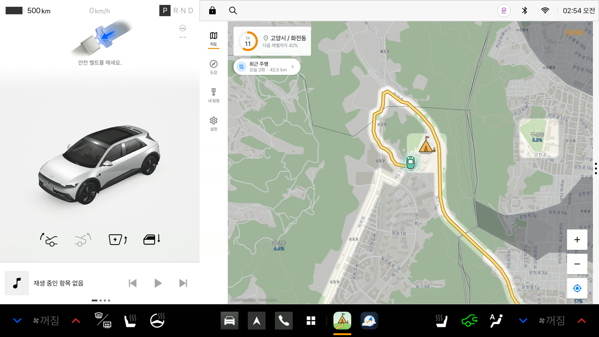
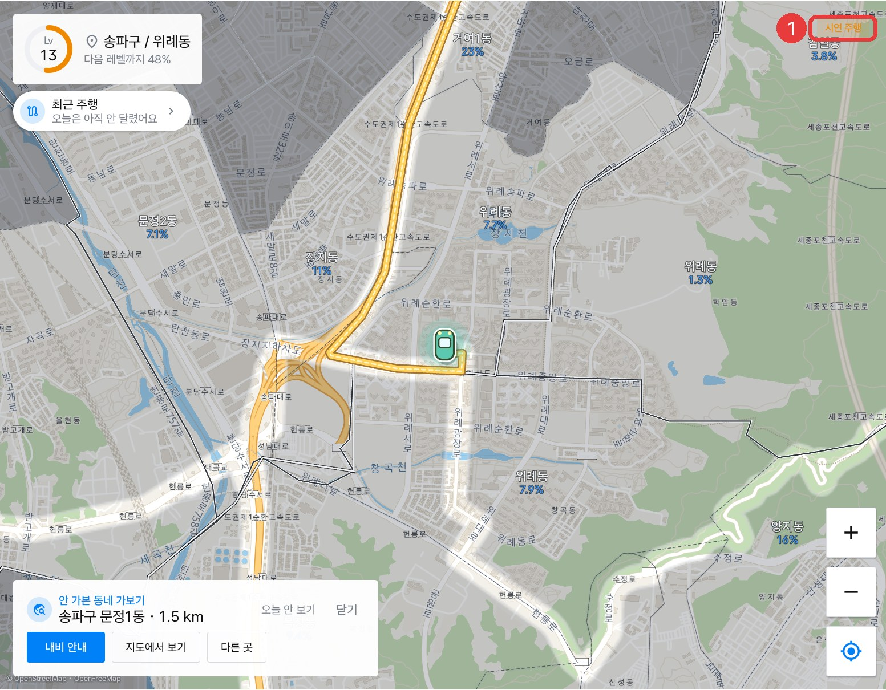
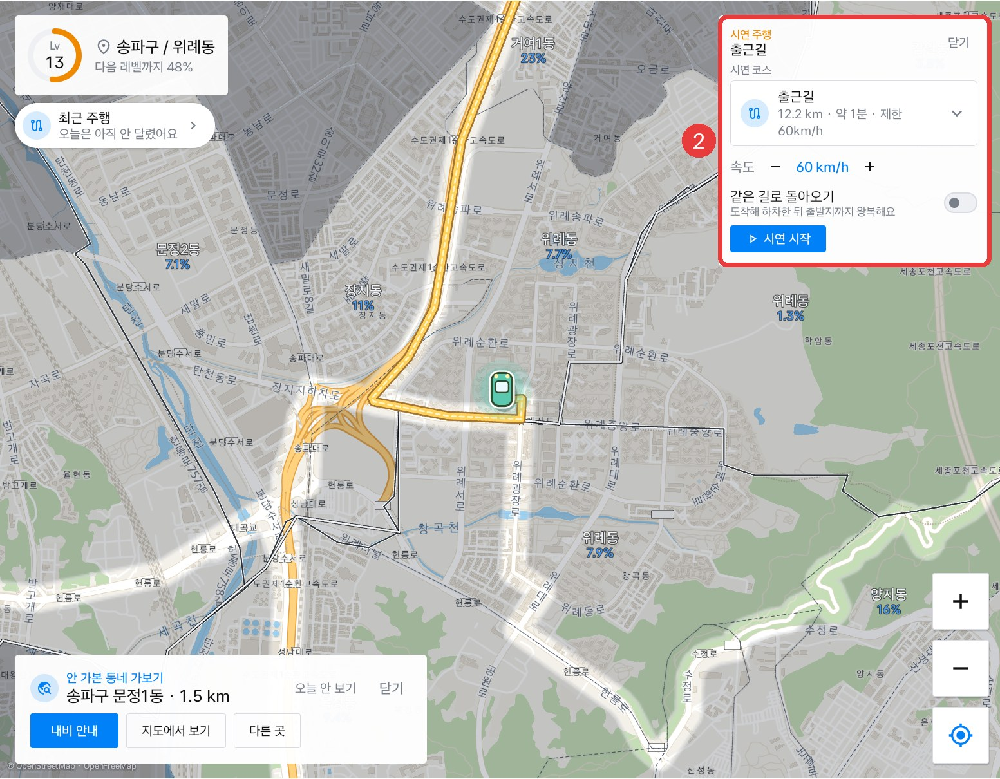

# 부릉탐험대

주행이 기록이 되고, 기록이 탐험이 되는 차량 전용 탐험 앱입니다. 시동만 걸면 달린 길이 노란 개척로로 지도에 새겨지고, 가 본 동네는 도감에, 주행의 순간은 스탬프와 칭호로 쌓입니다.

Pleos Connect(Android Automotive OS) 앱 · 현대자동차그룹 차량용 앱 개발 공모전 출품작 · 팀 zobo



## APK

- 저장소: [`apk/zobo_Burung_release.apk`](apk/zobo_Burung_release.apk)
- GitHub Release: [v0.1.0](https://github.com/TEAM-zobo/fogdrive/releases/tag/v0.1.0)
- 패키지 `com.zobo.burung` · 버전 0.1.0 · minSdk 28 · targetSdk 35 · ABI arm64-v8a, x86_64

## 테스트 환경

| 항목 | 버전 |
| --- | --- |
| 에뮬레이터 | Pleos Connect Emulator v2.1.0 (Android 14, API 34), AVD RAM 4GB, Cold boot |
| Pleos SDK | Vehicle 2.3.2 · NaviHelper 3.0.5 · FusedLocation 1.1.3 · TextToSpeech 3.3.1 |
| 빌드 | JDK 17 · Gradle 8.10.2 · AGP 8.8.2 · Kotlin 2.0.21 · compileSdk 35 |
| 필요한 설정 | 에뮬레이터 인터넷 연결(지도 타일), 기어 P단(앱 화면은 P단에서만 보임) |

## 실행 방법

### APK로 실행

```bash
adb install -r -g apk/zobo_Burung_release.apk
adb shell am start -n com.zobo.burung/.ui.MainActivity
```

- `-g`로 위치·알림 권한을 미리 허용합니다. 빼면 첫 실행 때 권한을 요청합니다.
- 처음 실행하면 튜토리얼(5장)이 뜨고, 끝나면 지도가 나옵니다.
- 화면이 검게 가려지면 기어가 P단이 아닌 것입니다. Virtual Console에서 P로 바꿉니다.

### 에뮬레이터부터 한 번에 셋팅

SDK·Pleos 에뮬레이터 이미지 설치, AVD 생성, 부팅, 빌드·설치·실행까지 스크립트 하나로 합니다. 자세한 내용과 문제 해결은 [docs/SETUP.md](docs/SETUP.md)에 있습니다.

```bash
tools/setup/setup.sh all   # macOS (Apple Silicon)
```

```powershell
powershell -ExecutionPolicy Bypass -File tools\setup\setup.ps1 all   # Windows 10/11 (하이퍼바이저 필요)
```

### 소스에서 빌드

```bash
./gradlew :app:assembleRelease   # keystore.properties가 없으면 debug 키로 서명
```

## 시연 방법

### 시연 모드 (권장)

에뮬레이터에서도 실제 도로를 달리는 것처럼 주행을 재생합니다. 지도 화면에서 바로 시작할 수 있습니다.

1. 지도 오른쪽 위의 **시연 주행**을 누릅니다.
2. 코스와 속도를 고르고 **시연 시작**을 누릅니다.

| ① 지도 오른쪽 위 「시연 주행」 | ② 코스 선택 → 「시연 시작」 |
| --- | --- |
|  |  |

출발하면 주행 모드로 바뀌어 지나간 길이 열리고, 도착하면 차가 P단으로 서고 도어가 열려 도착 결산 카드가 나옵니다. 같은 설정은 **설정 → 시연 모드**에도 있습니다.

| 코스 | 보여 주는 것 |
| --- | --- |
| 출근길 (위례 집 → 양재 회사) | 일상 주행으로 쌓이는 경험치, 최근 주행 "집 → 회사" |
| 토요일 코스트코 장보기 | 동승자와 함께 탐험 → '오늘은 함께 탐험했어요!' |
| 강릉 경포대 여행 (분기 1회) | 처음 가 본 동네가 한꺼번에 열리고, 도착하면 레벨 업·새 스탬프('멀리 떠난 날' 등) |

이 밖에 주말 근교 코스 8곳이 있습니다. 속도는 주행 중에도 바꿀 수 있고, **시연 중지**를 누르면 실제 위치로 돌아갑니다. 에뮬레이터의 내비는 경로 안내를 하지 못해서, 회전 안내·제한속도·도착은 시연 주행이 대신 만들어 줍니다.

### 차량 신호로 직접 (Virtual Console)

```bash
adb forward tcp:8088 tcp:8088   # 브라우저에서 http://127.0.0.1:8088/
```

기어(P/D), 도어, 좌석, 와이퍼, 전조등, 배터리, 주행 가능 거리를 바꾸면 앱이 그대로 반응합니다. **설정 → 연결 상태**에서 SDK 연결과 차량 상태를 확인할 수 있습니다.

## 주요 기능

| 기능 | 내용 | 차량 데이터 |
| --- | --- | --- |
| 자동 개척 기록 | 시동이 켜지면 앱을 열지 않아도 기록. 달린 길만 밝아지고 이번 주행은 노란 개척로 | FusedLocation |
| 베이스캠프 · 목적지 깃발 | 내비의 '집'에 텐트, 목적지에 깃발. 최근 주행에 "집 → 회사"처럼 즐겨찾기 이름 | NaviHelper 즐겨찾기·목적지 |
| 하차 지점 | P단에서 도어가 열린 곳 주변을 넓게 개척하고 깃발 | 기어, 도어 |
| 레벨 (Lv.1–50) | 새 길이 아니어도 1km마다 경험치. 출퇴근만으로 1주 Lv.4, 1달 Lv.7 정도 | 주행 거리 |
| 스탬프 11개 · 칭호 5개 | 꾸준함·넓힘·함께·여행 분야 스탬프, 분야를 다 모으거나 출퇴근 20회·섬 방문·서울 25개 구로 칭호 | 주행 기록, 좌석, 내비 즐겨찾기 |
| 이번 주 탐험 추천 | 월요일마다 이번 주에 받을 만한 스탬프 3개, 가까운 안 가 본 곳 | 주행 기록, 내비 집 위치 |
| 도착 결산 | 도착 후에만 이번 주행 요약, 처음 가 본 동네, 레벨 업·새 칭호·스탬프 | 기어, 좌석 |
| 지역 도감 | 시·도 → 시·군·구 → 읍·면·동 개척률, 다음 탐험 후보 → 내비 안내 | NaviHelper 경로 요청 |
| 탐험 우회 경로 | 출발 전 '1분 더 쓰면 안 가 본 동네를 지나요' 경유지 제안 | NaviHelper 경유지, 주행 가능 거리 |
| 음성 안내 | 처음 들어선 동네, 도착 요약, 레벨 업을 짧게 음성으로. 화면을 보지 않아도 성과를 앎 | TextToSpeech (온디바이스) |
| 키즈모드 | 화면 문구와 음성 안내를 아이 말투로 | TextToSpeech |
| 주행 모드 | 주행 중에는 지도·현재 위치·짧은 숫자만, 탭과 카드는 정차 중에만 | CarUxRestrictions |

| | |
| --- | --- |
|  주행 모드 |  도착 결산 |
|  지역 도감 |  내 탐험: 칭호와 이번 주 탐험 추천 |

## 데이터와 출처

- 위치 기록은 기기 안(Room DB)에만 저장하고, 설정에서 전체 삭제할 수 있습니다. 운전자 프로필마다 따로 쌓입니다.
- 지도: MapLibre Android 10.3.7 + OpenFreeMap 타일 (© OpenStreetMap contributors)
- 행정구역 경계: [admdongkor](https://github.com/vuski/admdongkor) ver20261001 (CC BY 4.0, 원자료 통계청)
