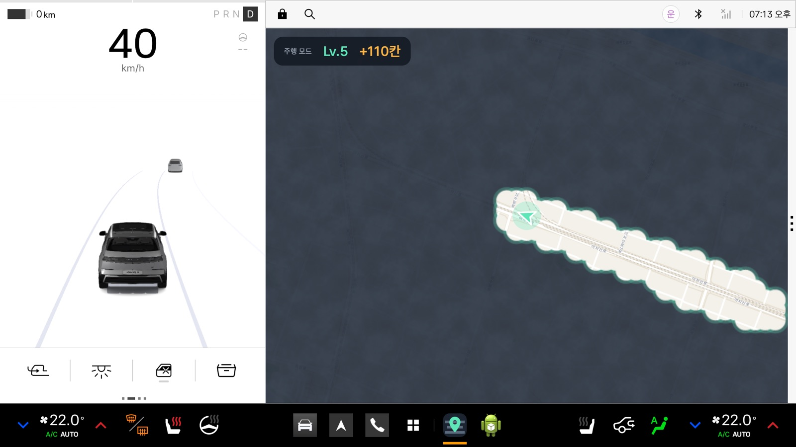
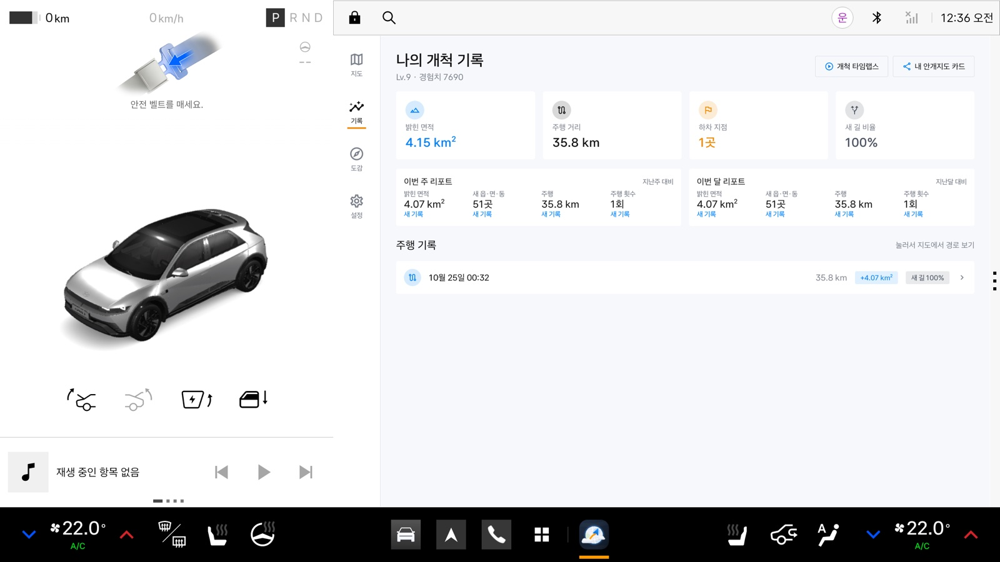
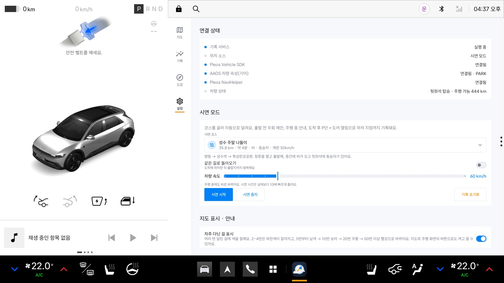
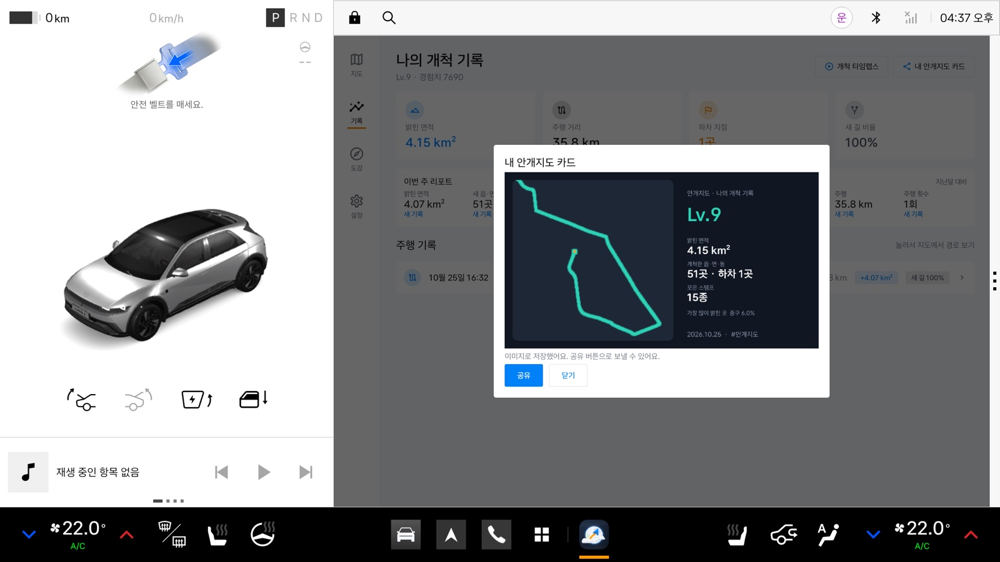
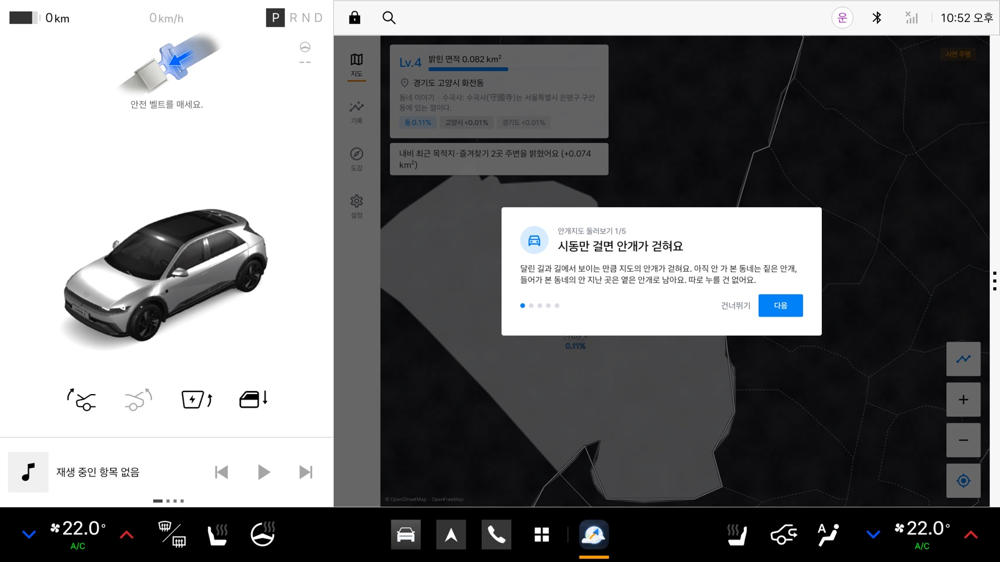
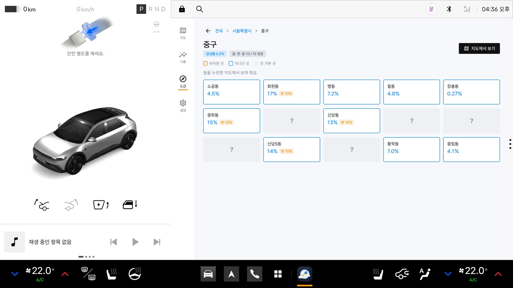
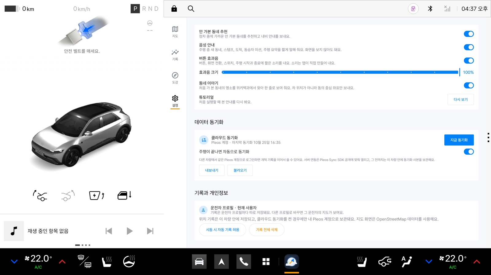

# 안개지도 (FogDrive)

시동만 걸면 달린 길의 안개가 걷히고, 아직 안 가본 동네는 안개로 남는 차량 전용 탐험 지도입니다.

Pleos Connect(Android Automotive OS) 앱이며, 현대자동차그룹 차량용 앱 개발 공모전 출품작입니다. 팀 zobo.



## 화면

2026-10-25, Pleos Connect 에뮬레이터 v2.1.0에서 시연 모드(성수 주말 나들이)로 촬영했습니다. 왼쪽은 에뮬레이터 차량 패널, 오른쪽이 앱입니다.

| | |
| --- | --- |
|  출발 전(P단): 탐험 우회 경로 제안 |  주행 모드: 회전 안내·제한속도, 도로 양쪽만 걷힘 |
|  도착: 이번 주행 요약, 처음 가 본 동네 |  정차 중 지도: 2단계 안개, 안 가본 동네 추천 |
|  기록: 밝힌 면적·주행 거리·하차 지점·새 길 비율, 이번 주/이번 달 리포트, 개척 타임랩스 |  지역 도감: 시·도별 달성률 |
|  스탬프 29종 |  설정: SDK 연결 상태, 시연 모드 |
|  내 안개지도 카드(공유 이미지) |  첫 실행 튜토리얼 |
|  도감 동 카드: 개척 단계 배지 |  설정: 운전자 프로필별 기록, 동기화 |

## APK

- Release APK: [`apk/zobo_FogDrive_release.apk`](apk/zobo_FogDrive_release.apk)
- 패키지: `com.zobo.burung` · 버전 0.1.0 · minSdk 28 · targetSdk 35 · ABI arm64-v8a, x86_64
- Release 빌드는 R8 + 리소스 축소를 적용합니다(74MB → 약 36MB). 대부분은 지도 엔진(MapLibre) 네이티브 라이브러리 두 ABI(26MB)이고, 설치 후 압축을 풀어 복사하지 않고 바로 매핑하도록 비압축으로 넣습니다.

## 주요 기능

### 탐험 기록

| 기능 | 내용 | 사용 SDK/API |
| --- | --- | --- |
| 자동 안개 걷기 | 주행 경로를 약 30m 격자로 기록해 도로와 눈에 보이는 범위(도로 양쪽 약 45m)만 안개를 걷음. 같은 길을 다시 달린 횟수도 기록 | Pleos FusedLocation (미지원 시 Android GPS) |
| 하차 지점 | P단 전환 후 도어가 열린 곳 주변(약 210m)을 걷고 핀 표시. 가까운 핀은 번호 핀으로 묶음 | AAOS `GEAR_SELECTION`, Pleos Vehicle Door |
| 첫 실행 지도 채우기 | 내비 최근 목적지·즐겨찾기 주변을 미리 걷음 | Pleos NaviHelper |
| 탐험 우회 경로 | 출발 전 목적지 근처의 안개 구역을 찾아 경유지로 추가 | NaviHelper `getDestinationInfo`, `addWaypoint` |
| 목적지·경유지 도착 | 목적지 도착 시 주변 약 150m, 탐험 경유지 도착 시 약 210m를 걷고 "목적지 정복"·"안개 원정" 스탬프 | NaviHelper 경로 안내 상태 |
| 안 가본 동네 추천 | 가장 가까운 미탐험 읍·면·동을 카드로 제안하고 내비 안내 요청 | NaviHelper `requestRoute` |
| 주행 안내 | 주행 화면에 다음 회전 안내(화살표·거리)와 제한속도 표지판 | NaviHelper |
| 음성 안내 | 주행 중 처음 들어선 동네, 동네 개척률 단계, 하차 후 주행 요약을 짧게 말함. 몰아서 생긴 안내는 쌓지 않고 건너뜀 | Pleos TextToSpeech SDK 3.3.1 (온디바이스 합성, 내비 안내 오디오) |
| 주행 요약 | 하차하면 이번 주행의 밝힌 면적·거리·새 길 비율, 처음 가 본 동네와 그 동네 이야기, 스탬프, 미션 결과를 카드로 보여 줌 | 앱 내부 계산 |
| 동승자 미션 | 조수석·뒷좌석에 동승자가 있으면 주행마다 미션(새 동 2곳 / 안개 0.1 km² / 새 길 3 km) 하나. 주행 화면에는 진행 한 줄만 보이고, 성공하면 "함께한 미션" 스탬프 | Pleos Vehicle Seat |
| 동네 이야기 | 처음 가 본 읍·면·동의 명소를 위키백과에서 찾아 한 줄로 소개(지도 헤더, 주행 요약). 차 위치가 아니라 동 중심 좌표만 보내고 결과는 기기에 저장 | 위키백과 API |
| 주행 가능 거리 반영 | 남은 주행 가능 거리로 목적지까지 갔다가 돌아올 수 없는 우회 경로는 제안하지 않음 | Pleos Vehicle Odometer `RangeRemaining` |

처음 실행하면 다섯 장짜리 튜토리얼이 뜨고, 설정에서 다시 볼 수 있습니다.

탐험 우회 경로와 동네 추천 카드는 "오늘 안 보기"로 하루 숨기거나 설정에서 끌 수 있습니다.

### 지도

- 안개는 2단계입니다. 한 번도 들어가지 않은 읍·면·동은 지도가 보이지 않는 짙은 안개, 들어가 본 읍·면·동의 아직 안 지난 곳은 지도가 비치는 옅은 안개이고, 지나간 길은 걷힙니다. 구름 질감에 걷힌 경계는 은은한 민트 빛으로 그립니다.
- 행정구역 경계선과 이름을 함께 그리고, 열린 지역 안에서도 동·구 경계가 보입니다.
- 달린 길은 어두운 막이 걷힌 띠로 남고, 이번 주행 길은 노란 막대로 표시됩니다. 내비 목적지에는 깃발, 내비의 집에는 베이스캠프 텐트가 뜹니다.
- 지도는 안개지도 전용 주간·야간 스타일을 앱에 포함해 씁니다(`app/src/main/assets/map/`). OpenFreeMap 타일 위에 앱 색상에 맞춘 팔레트, 한국어 라벨(`name:ko`, 1.4배), 굵은 도로 위계를 적용했고 시스템 주간/야간 설정을 따릅니다. `python3 tools/mapstyle/build_styles.py`로 다시 만들 수 있습니다.
- 면적은 모두 km²로 표기합니다.

### 기록·도감·챌린지

| 화면 | 내용 |
| --- | --- |
| 기록 | 밝힌 면적, 새 길 비율, 총거리, 주행 목록. 주행을 누르면 지도에 그 주행 경로를 표시. **내 안개지도 카드**: 개척한 곳을 빛나는 칸으로 그린 공유용 이미지(PNG, 1600×900)에 레벨·면적·동 수·가장 많이 밝힌 시·군·구를 담아 저장하고, 공유할 앱이 있으면 공유 |
| 지역 도감 | 시·도 → 시·군·구 → 읍·면·동 단계별 달성률(걷은 면적 비율). 한 칸이라도 지난 지역만 열리고 나머지는 "?". 하차한 지역은 주황 카드와 깃발 수로 표시. 동을 누르면 지도에서 보여 줌 |
| 챌린지 | 오늘 / 이번 주 / 이번 달 / 시즌(3개월) 탭, 기간별 5~7개 목표(면적, 거리, 새 동·시·군·구·시·도, 하차, 스탬프 종류) |
| 스탬프 29종 | 아래 표 |
| 레벨 | 밝힌 칸당 1 XP + 새 스탬프 종류 보너스. 레벨 L에 (L-1)^2.5 × 40 XP가 필요해서 하루 2 km² ≈ Lv.6, 시즌 15 km² ≈ Lv.13 |

| 분류 | 스탬프 |
| --- | --- |
| 차량 상황 | 빗속 개척(와이퍼), 야간 개척(전조등), 비 오는 밤, 가족 탐험(뒷좌석), 만석 드라이브(동승자 2명 이상), 충전소 깃발(정차 중 배터리 상승), 아슬아슬 탐험(배터리 20% 이하), 바람길 개척(창문 열림), 하늘 열고 개척(선루프), 에코 탐험가(에코 모드), 스포츠 개척(스포츠 모드) |
| 시간 | 새벽 개척, 노을 드라이브, 심야 질주, 출근길 개척, 주말 탐험가 |
| 주행 | 장거리 원정(30 km), 마라톤 드라이브(100 km), 개척왕(0.1 km²), 완전 개척(새 길 90%), 귀소 본능, 첫 시동 |
| 내비 | 목적지 정복, 안개 원정 |
| 동승자 | 함께한 미션(동승자 미션 성공) |
| 지역 | 새 동네 첫발(새 시·군·구), 동네 순례(새 동 5곳), 경계 넘어(시·도 경계), 새 땅 밟기(새 시·도) |

### 데이터

- 위치 기록은 기기 내부(Room DB, 스키마 v4)에 저장합니다. DB 버전이 바뀌어도 마이그레이션으로 기존 기록을 유지합니다.
- 설정 → 데이터 동기화: 백업 내보내기·불러오기(바이너리+gzip, 예전 JSON 백업도 불러옴), 클라우드 동기화, 주행 종료 시 자동 동기화. Pleos Sync SDK가 아직 Playground maven에 공개되지 않아서, 지금은 백업을 기기 안 보낼 함(outbox)에 쌓아 두는 대체 구현입니다. SDK가 공개되면 그 부분만 바꿉니다.

### 주행 모드와 성능

기록은 포그라운드 서비스가 맡아서 화면이 꺼져 있어도 계속됩니다. 액티비티는 distraction-optimized로 선언했고, 주행 중(CarUxRestrictions)에는 **주행 모드**로 바뀌어 지도·현재 위치·레벨·현재 동·이번 주행 새 칸·회전 안내·제한속도·동승자 미션 진행만 보여줍니다. 나머지 정보는 음성으로 전합니다. 탭, 기록, 도감, 설정, 탐험 제안은 정차 중에만 열립니다. 주행 중 차 표시는 진행 방향 화살표입니다.

주행 모드는 차를 화면 중앙에 고정한 채, 지도를 매번 다시 그리지 않고 **미리 넓게 그린 지도를 밀어서** 움직입니다. 1초 간격 위치 사이는 선형 보간으로 이어서 화면이 끊기지 않고, 지도 재렌더링은 밀린 거리가 여백에 가까워질 때만(40km/h 기준 약 30초마다) 합니다. 재렌더링한 지도는 카메라 이동 뒤 2프레임이 지난 다음 받아들여서, 옛 지도와 새 위치가 한 프레임 겹쳐 보이며 흔들리던 문제를 없앴습니다(200km/h 녹화에서 역방향 점프 0회). 멈춰 있으면 프레임 루프도 쉬고, 정차 화면은 여백 없이 화면 크기만큼만 그립니다. 주행 중에는 건물·골목 이름 등 세부 레이어를 숨기고 최대 20fps로 제한합니다.

| 주행 모드 성능 (Pleos 에뮬레이터, 4코어 기준) | CPU | 메모리(PSS) |
| --- | --- | --- |
| 최적화 전 (매 위치마다 카메라 이동) | 9.5% | 214MB |
| 최적화 후 40km/h | 3.6% | 157MB |
| 최적화 후 100km/h | 6.2% | 163MB |
| 최적화 후 D단 정지(신호 대기) | 0.2% | - |

측정: `cd qa && python3 -m fogqa perf` (화면 에뮬레이터). 창 없는 QA 에뮬레이터(`perf --headless`)는 렌더링 방식이 달라 값이 더 크게 나오므로, 변경 전후 비교는 같은 에뮬레이터끼리 합니다. 2026-10-25 기능 추가 전후를 QA 에뮬레이터에서 비교한 결과 40km/h CPU 11.0% → 10.4%, 100km/h 21.1% → 21.6%로 차이가 측정 오차 안이었습니다.

그 밖의 최적화:

- 지역 경계 데이터(`kr_regions.bin`, 약 4MB)를 APK에 비압축으로 넣고 메모리 매핑으로 읽습니다. 경계 조회 버킷을 5km로 키워 로딩이 4.3초에서 1.3초로 줄었습니다. 로딩 중에는 짙은 안개를 유지하고, 파일을 못 읽으면 한 단계 안개로 대체합니다.
- 지역 집계는 새로 추가된 칸만 세고, 지도 상단·주행 화면은 가벼운 집계만 씁니다.
- 시연 위치는 최대 초당 5회로 보냅니다(경로가 꺾이는 지점은 항상 전송). UI 재구성이 15초에 185회에서 108회로 줄었습니다.
- 안개는 직전 조각과 영역·배율이 같으면 바뀐 부분(새 칸, 재방문 칸)만 지우고 다시 그립니다. 주행 중 안개 렌더링 스레드 CPU가 10초당 1,580 ms에서 720 ms로 줄었습니다.
- 기본 프로필(`app/src/main/baseline-prof.txt`)로 앱 코드를 설치 때 미리 컴파일합니다.

## 테스트 환경

| 항목 | 버전 |
| --- | --- |
| 에뮬레이터 | Pleos Connect Emulator v2.1.0 (Android 14, API 34, arm64) |
| Pleos SDK | Vehicle 2.3.2 · NaviHelper 3.0.5 · FusedLocation 1.1.3 |
| 빌드 | JDK 17 · Gradle 8.10.2 · AGP 8.8.2 · Kotlin 2.0.21 · compileSdk 35 |
| 지도 | MapLibre Android 10.3.7 + OpenFreeMap 타일 (© OpenStreetMap contributors) |
| 행정구역 경계 | [admdongkor](https://github.com/vuski/admdongkor) ver20261001 (CC BY 4.0, 원자료 통계청). `python3 tools/regions/build_regions.py`로 `app/src/main/assets/regions/kr_regions.bin` 재생성 |

### 셋팅 (macOS / Windows)

SDK 설치, Pleos 에뮬레이터 이미지 설치, AVD 생성, 부팅, 빌드·설치·실행까지 스크립트 하나로 합니다. OS별 준비물, 단계별 실행, 문제 해결은 **[docs/SETUP.md](docs/SETUP.md)** 를 보세요.

**macOS** (Apple Silicon)

```bash
tools/setup/setup.sh doctor   # 빠진 것 점검
tools/setup/setup.sh all      # SDK → Pleos 이미지(약 4.7GB) → AVD → 부팅 → 빌드·설치·실행
```

**Windows** (10/11, Intel·AMD, 하이퍼바이저 필요)

```powershell
powershell -ExecutionPolicy Bypass -File tools\setup\setup.ps1 doctor
powershell -ExecutionPolicy Bypass -File tools\setup\setup.ps1 all
```

**Claude Code로 셋팅**: 저장소를 열고 "docs/SETUP.md대로 테스트 환경 셋팅하고 앱 실행해줘"라고 요청하면 됩니다. 절차는 [`CLAUDE.md`](CLAUDE.md)에 요약되어 있습니다.

스크립트 대신 Android Studio로 직접 셋팅하려면 [Pleos Connect Emulator 설치 및 실행](https://document.pleos.ai/docs/connect/guide/getting-started/application-development/setup-connect-sdk-emulator) 문서를 따릅니다(요약은 [docs/SETUP.md](docs/SETUP.md#android-studio로-직접-셋팅-macoswindows-공통-스크립트-대신)). AVD는 Cold boot, RAM 4GB로 설정합니다. 지도 타일을 받으려면 에뮬레이터에 인터넷 연결이 필요합니다.

앱의 기본 위치(위치가 없을 때의 지도 시작점)는 시연 페르소나의 집인 위례(송파꿈에그린 위례24단지)입니다. 셋팅 스크립트의 `boot` 단계가 에뮬레이터 위치를 여기로 맞춥니다. 따로 맞추려면 macOS는 `tools/emulator/set_home.sh`, Windows는 `adb emu geo fix 127.13960 37.47588`를 실행합니다.

## 실행 방법

### APK 설치

```bash
adb install -r -g apk/zobo_FogDrive_release.apk
adb shell am start -n com.zobo.burung/.ui.MainActivity
```

`-g`를 빼고 설치하면 첫 실행 때 위치·FusedLocation·알림 권한을 요청합니다. 권한을 허용하면 기록 서비스가 시작됩니다.

### 소스에서 빌드

```bash
./gradlew :app:assembleDebug        # app/build/outputs/apk/debug/app-debug.apk
./gradlew :app:testDebugUnitTest    # 단위 테스트 71개
./gradlew :app:assembleRelease      # keystore.properties가 없으면 debug 키로 서명
```

Windows는 `./gradlew` 대신 `gradlew.bat`를 씁니다. 빌드부터 설치·실행까지 한 번에 하려면 `tools/setup/setup.sh app`(Windows `setup.ps1 app`)을 실행합니다.

Release 서명 정보는 저장소 밖의 `keystore.properties`(gitignore)에서 읽습니다.

## 시연 방법

### 1. 시연 모드 (권장)

앱의 **설정 → 시연 모드**에서 코스를 고르고 **시연 시작**을 누른 뒤 **지도** 탭으로 이동합니다. 모든 코스는 시연 페르소나의 집(위례)에서 출발해 실제 도로 경로(OSRM)를 달립니다: 출근길(양재 현대자동차 본사), 토요일 코스트코 양재점, 주말 근교 6곳, 분기 1회 강릉. 페르소나의 10주치 기록은 `tools/demo/persona/make_persona_backup.py`로 만들고 `tools/demo/prepare_demo.py`로 넣습니다. 지도·주행 화면의 시연 제어 패널에서 속도 조절과 중지를 할 수 있습니다.

- 차량 속도: 20~200km/h(기본 60km/h), 주행 중에도 바로 반영됩니다. 시연 시간은 실제의 10배속으로 흐릅니다.
- 같은 길로 돌아오기: 도착해 하차한 뒤 출발지까지 같은 길로 왕복합니다.
- 코스 태그에 현재 속도 기준 예상 시연 시간이 나옵니다.
- 시연 차량은 주행 가능 거리 480 km로 출발하고, 도착할 때마다 달린 만큼 줄어듭니다.
- 주행이 끝나도 화면이 유지되고, 중지하지 않고 다시 달리거나 다른 코스를 시작할 수 있습니다. **시연 중지**를 누르면 실제 위치로 돌아갑니다.

| 코스 | 경로 | 거리 | 차량 이벤트 |
| --- | --- | --- | --- |
| 성수 주말 나들이 | 성수역 → 뚝섬한강공원 | 약 36 km | 창문 열기, 비, 뒷좌석 동승자(미션) |
| 여의도 야경 드라이브 | 국회의사당 → 여의도한강공원 | 약 16 km | 전조등, 조수석 동승자(미션) |
| 강남 출근길 | 강남역 → 코엑스 | 약 25 km | - |
| 홍대·망원 동네 마실 | 홍대입구역 → 망원동 | 약 12 km | 비, 동승자, 제한 30 |
| 상암 월드컵공원 산책 | 상암동 → 월드컵공원 | 약 7 km | 가장 짧은 코스 |
| 은평한옥마을 마실 | 구파발 → 은평한옥마을 | 약 9 km | 동승자, 제한 30 |
| 일산 호수공원 저녁 | 일산 → 호수공원 | 약 16 km | 전조등 |
| 광화문 나들이 | 서대문 → 광화문 | 약 12 km | - |
| 김포공항 마중 | 강서 → 김포공항 | 약 13 km | 내내 비 |
| 남산 야경 | 서울역 → 남산 순환로 | 약 22 km | 전조등, 동승자 |
| 파주·김포 한 바퀴 | 파주 운정 → 김포 | 약 42 km | 동승자 |
| 판교 테크노밸리 출장 | 서울 강남 → 성남 판교 | 약 37 km | 에코 모드 |
| 송도 바닷바람 | 부천 → 인천 송도 | 약 40 km | 전조등, 선루프, 조수석 동승자(미션) |
| 의정부·남양주 동부 원정 | 의정부 → 남양주 | 약 56 km | 비 |
| 수원 화성 나들이 | 광명 → 안양 → 수원 | 약 53 km | - |
| 부산 해운대 장거리 여행 | 경부고속도로 → 대전 → 대구 → 부산 | 약 415 km | 장거리 |
| 강릉 경포대 동해 여행 | 영동고속도로 → 원주 → 강릉 | 약 231 km | 장거리, 스포츠 모드, 도착 무렵 창문 열기 |

한 번의 시연은 다음 순서로 진행됩니다.

1. 출발 전(P단): 탐험 우회 경로 카드가 나타납니다.
2. 주행 중: 안개가 걷히고, 회전 안내·제한속도가 표시되며, 코스에 따라 빗속·야간·가족 탐험·바람길·선루프·에코·스포츠 스탬프와 동승자 미션이 나옵니다. 처음 들어선 동네와 동네 개척률 단계는 음성으로 알려 줍니다.
3. 도착: 목적지 정복 스탬프, P단 + 운전석 도어 열림으로 하차 지점이 기록되고, 이번 주행 요약 카드와 음성 요약이 나옵니다.

에뮬레이터 내비는 GPS 체크섬 문제로 경로 안내를 하지 못해서, 시연 주행이 회전 안내·제한속도·도착 이벤트를 대신 만들어 줍니다.

### 2. 실제 차량 신호로 시연 (Virtual Console)

```bash
adb forward tcp:8088 tcp:8088     # 브라우저에서 http://127.0.0.1:8088/
adb emu geo fix 127.0559 37.5446  # 위치 이동 (경도, 위도)
```

Virtual Console에서 기어(P/D), 도어, 창문, 와이퍼, 전조등, 좌석, 배터리, 주행 가능 거리를 바꾸면 앱이 그대로 반응합니다. 설정 탭의 **연결 상태**에서 각 SDK 연결과 현재 차량 상태를 확인할 수 있습니다.

## 설정 화면

| 섹션 | 항목 |
| --- | --- |
| 연결 상태 | 기록 서비스, 위치 소스, Vehicle SDK·AAOS 기어·NaviHelper 연결, 현재 차량 상태(도어·좌석·와이퍼·전조등·창문·선루프·주행 모드·배터리·주행 가능 거리·누적 거리) |
| 시연 모드 | 코스 선택, 왕복, 차량 속도, 시연 시작·중지, 기록 초기화 |
| 지도 표시 · 안내 | 탐험 우회 경로·동네 추천 표시, 음성 안내, 동네 이야기, 튜토리얼 다시 보기 |
| 데이터 동기화 | 클라우드 동기화, 주행 종료 시 자동 동기화, 백업 내보내기·불러오기 |
| 기록과 개인정보 | 시동 시 자동 기록 허용, 기록 전체 삭제 |

## 시연·홍보 영상

에뮬레이터에서 앱을 자동 조작하며 구간별로(소리 포함) 녹화하고, [HyperFrames](https://github.com/heygen-com/hyperframes)로 자막·카메라 워크·배경음악을 입혀 1분 46초 홍보 영상을 만듭니다. 결과물은 `tools/demo/promo/renders/fogdrive-promo.mp4`(git 제외)입니다. 같은 녹화본으로 세로 숏폼(47초, `tools/demo/shortform`)도 만듭니다.

```bash
tools/setup/setup.sh video        # 한 번: ffmpeg, Node.js 22+, HyperFrames 0.8.196 + Claude Code 스킬 (Windows: setup.ps1 video)
tools/setup/setup.sh boot --record  # 녹화용 QA 에뮬레이터(소리 켬, 주간 시계)
# 녹화 → 편집 → 렌더링 순서와 수정 방법: docs/VIDEO.md
```

녹화 없이 지금 영상을 그대로 다시 렌더링할 수도 있습니다. 장면 클립·음악·글꼴은 GitHub Release `demo-assets-v1`에 있고, `tools/demo/promo/prepare_assets.sh`가 녹화본이 없으면 자동으로 받습니다(`gh auth login` 필요).

자세한 절차, 장면 구성, 수정 방법, 라이선스, 문제 해결은 **[docs/VIDEO.md](docs/VIDEO.md)** 에 있습니다.

## QA

Pleos 에뮬레이터에서 실제 SDK 경로로 기능별 TC 20개를 자동 실행하는 도구와 웹 대시보드가 `qa/`에 있습니다. 사용법은 [`qa/README.md`](qa/README.md), TC 목록은 [`docs/test-cases.html`](docs/test-cases.html)을 보세요.

## 구조

```
app/src/main/java/com/zobo/burung/
  car/        Vehicle SDK·AAOS 신호(창문·주행 모드·주행 가능 거리 포함), 위치 피드, NaviHelper 브리지
  record/     기록 규칙·스탬프(TripRecorder, 단위 테스트), 포그라운드 서비스, 부팅 수신기
  data/       Room DB(v4), 탐험 저장소, 백업, 클라우드 동기화
  explore/    탐험 우회 경로, 레벨, 챌린지, 지역 달성률 집계, 동승자 미션, 동네 이야기
  geo/        격자(웹 메르카토르 20레벨, 약 30m), 면적 표기, 행정구역 경계 조회
  demo/       시연 코스 17개, 시연 주행, 시연 설정
  voice/      음성 안내(TextToSpeech)
  ui/         Compose 화면(지도·주행·기록·도감·설정·시연 패널·튜토리얼·주행 요약), 지도 홀더, 안개 오버레이, 공유 카드, 테마
tools/
  mapstyle/   지도 스타일 생성
  regions/    행정구역 경계 바이너리 생성
  emulator/   에뮬레이터 기본 위치 설정
  setup/      테스트 환경 셋팅(macOS setup.sh, Windows setup.ps1)
  submission/ 접수양식 DOCX 생성(build_form.py)
  demo/       시연 영상: 예시 기록 생성 · 시연 상태 준비 · 구간별 녹화(docs/VIDEO.md)
    promo/    HyperFrames 홍보 영상 프로젝트(build.py가 장면 생성, SPEC.md 기획)
    shortform/ 세로 숏폼(1080×1920, 47초) 프로젝트. 홍보 영상 소재를 그대로 씀
qa/           에뮬레이터 자동 테스트·웹 대시보드
docs/
  submission/ 공모전 제출물(접수양식, 02 원고, 제출 이메일, 시연 영상·숏폼 콘티, GitHub 제출 요건)
  images/     앱 화면
```

## 문서

- [공모전 제출물](docs/submission/README.md): 무엇을 내는지, 접수양식(02 작성 완료), 복사해 쓰는 제출 이메일, 시연 영상·숏폼 콘티, 최종 점검표
- [테스트 환경 셋팅](docs/SETUP.md): macOS·Windows별 SDK·에뮬레이터 설치, 빌드·실행, 문제 해결
- [시연·홍보 영상](docs/VIDEO.md): 영상 도구 설치, 구간별 녹화, HyperFrames 편집·렌더링, 라이선스
- [공모전 준비 가이드](docs/index.html): 일정, 제출물, 접수양식 작성법, 일자별 계획, 개발 현황, 근거 링크
- [테스트 케이스](docs/test-cases.html): 기능별 TC 20개 (`qa/fogqa/cases.py`에서 생성)
