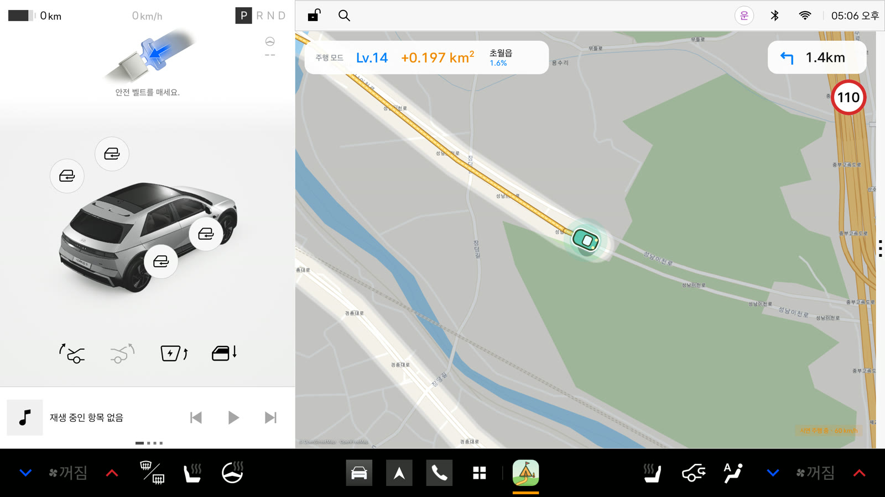
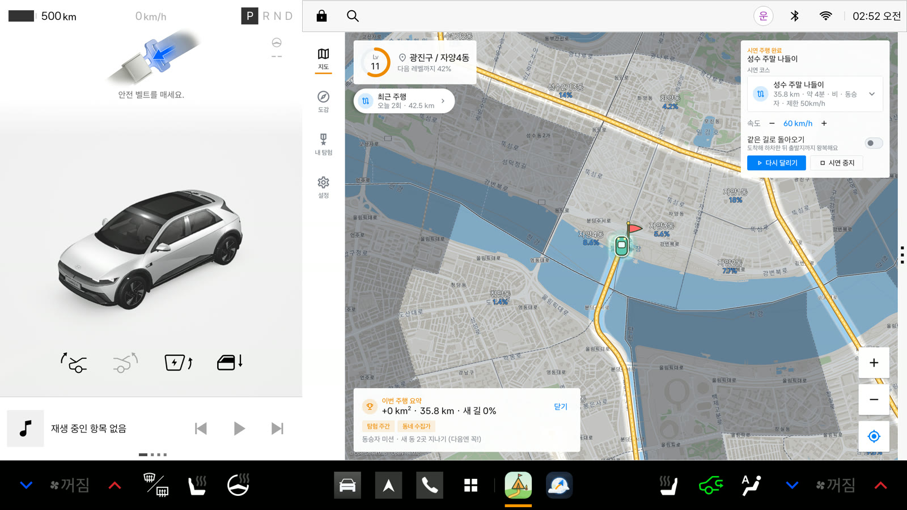
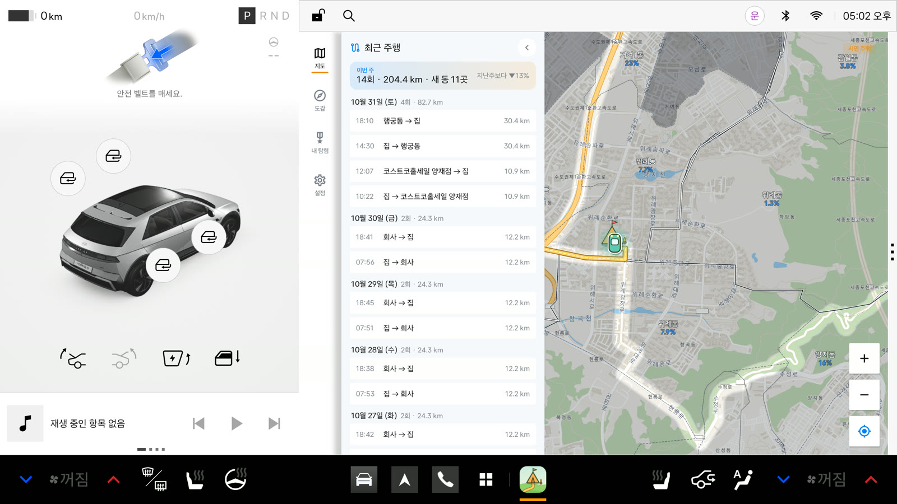
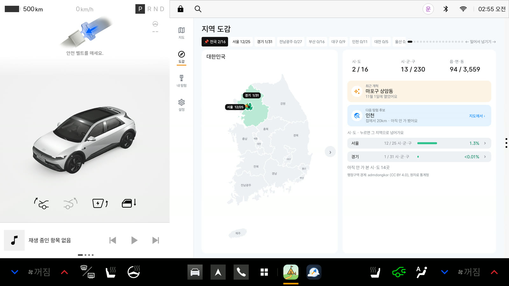
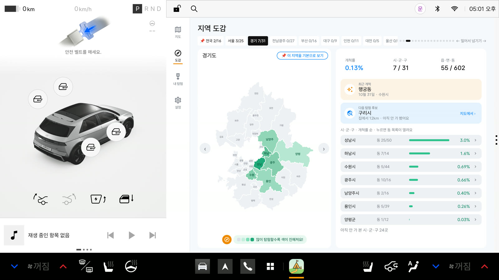
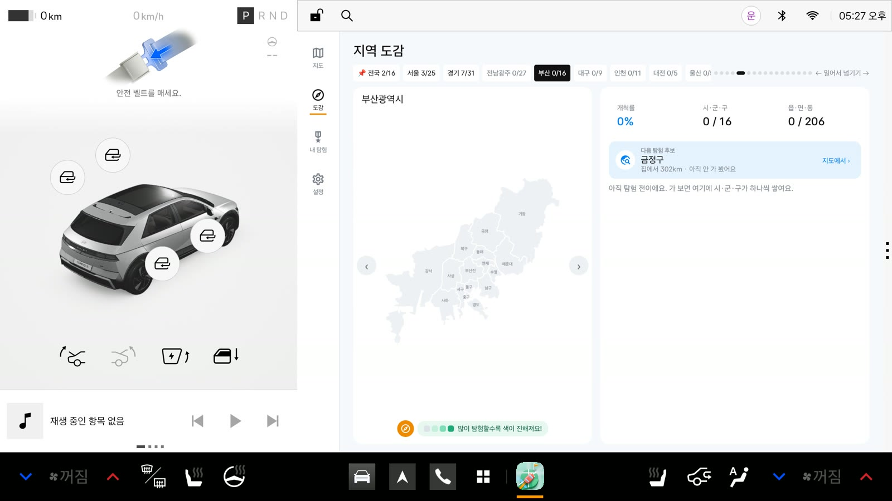
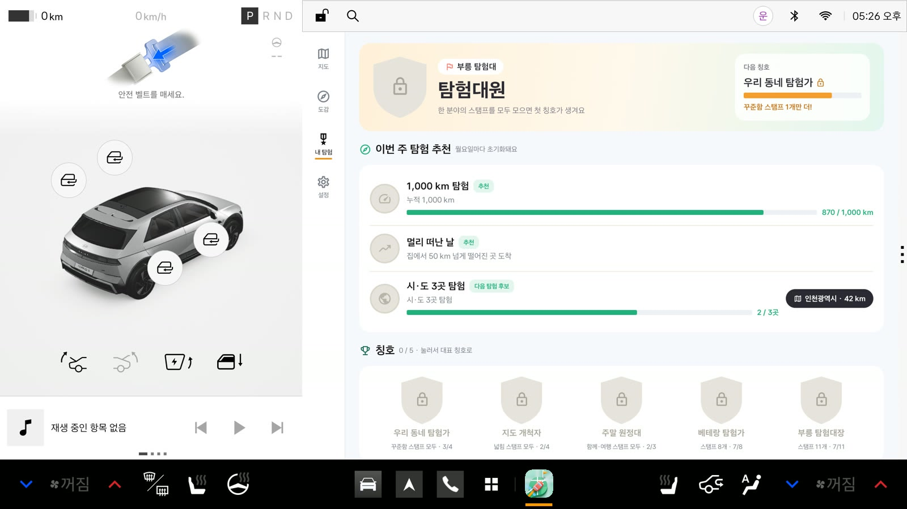
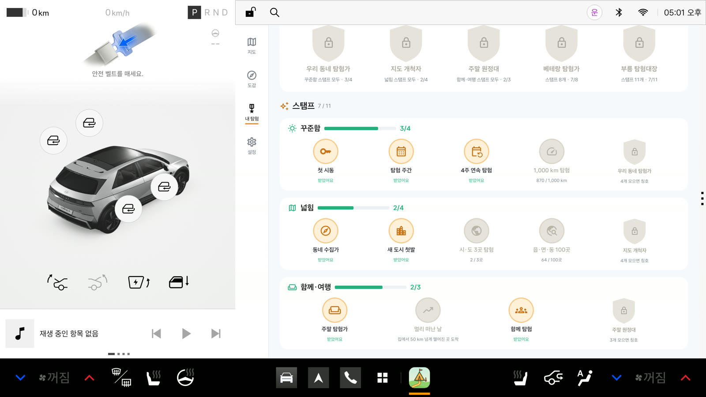
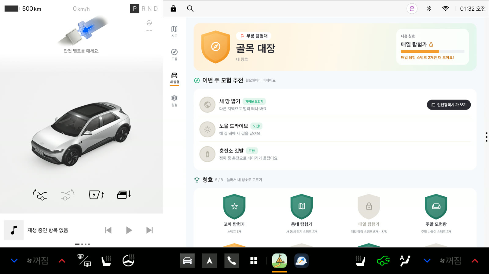
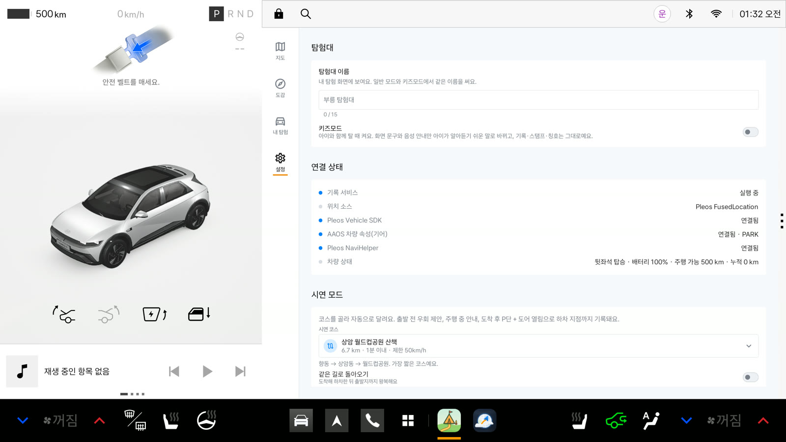

# 부릉탐험대

주행이 기록이 되고, 기록이 탐험이 되는 차량 전용 탐험 앱입니다. 집은 베이스캠프, 목적지는 탐험지: 달린 길은 노란 개척로로 지도에 새겨지고, 가 본 동네는 도감에, 주행의 순간은 스탬프와 칭호로 쌓입니다.

Pleos Connect(Android Automotive OS) 앱이며, 현대자동차그룹 차량용 앱 개발 공모전 출품작입니다. 팀 zobo.


## 화면

Pleos Connect 에뮬레이터 v2.1.0에서 시연 페르소나(위례에서 양재로 출퇴근하는 30대 직장인, 4주 기록)로 촬영했습니다. 왼쪽은 에뮬레이터 차량 패널, 오른쪽이 앱입니다.

| | |
| --- | --- |
|  주행 모드: 지나간 길만 열리고 노란 개척로, 회전 안내·제한속도 |  도착: 레벨 업, 처음 가 본 동네, 새 칭호·스탬프 |
|  최근 주행: 내비 즐겨찾기 이름으로 "집 → 회사" |  도감: 대한민국 지도에 가 본 시·도 색칠 |
|  도감: 시·도 슬라이드, 최근 개척과 다음 탐험 후보 |  도감: 안 가 본 시·도와 가까운 탐험 후보 |
|  내 탐험: 다음 칭호까지, 이번 주 탐험 추천 |  분야별 스탬프(코인)와 칭호(방패) |
|  키즈모드: 같은 화면, 아이 말투 문구 |  설정: 탐험대 이름과 키즈모드 |

## APK

- Release APK: [`apk/zobo_Burung_release.apk`](apk/zobo_Burung_release.apk)
- 패키지: `com.zobo.burung` · 버전 0.1.0 · minSdk 28 · targetSdk 35 · ABI arm64-v8a, x86_64
- Release 빌드는 R8 + 리소스 축소를 적용합니다(약 40MB). 대부분은 지도 엔진(MapLibre) 네이티브 라이브러리 두 ABI이고, 설치 후 압축을 풀어 복사하지 않고 바로 매핑하도록 비압축으로 넣습니다.

## 주요 기능

**서비스 흐름:** 주행 → 지도 개척(길·동네가 열림) → 스탬프·레벨 획득 → 스탬프가 모여 칭호 → 도감으로 방문 지역 확인 → 이번 주 탐험 추천·다음 탐험 후보

| 탭 | 내용 |
| --- | --- |
| 지도 | 탐험 지도(노란 개척로, 안 가 본 길·동네는 어둡게), 집 베이스캠프·목적지 깃발·하차 깃발, 레벨 원형 게이지와 현재 시·군·구/읍·면·동, '최근 주행' 패널(날짜별 주행 일지, 경로 다시 보기) |
| 도감 | 대한민국 지도(16개 시·도, 울릉도·독도 포함)에 가 본 지역 색칠, 전국·시·도 대시보드(개척률, 가 본 시·군·구/읍·면·동, 최근 개척, 다음 탐험 후보) |
| 내 탐험 | 대표 칭호와 탐험대 이름, 다음 칭호까지 진행, 이번 주 탐험 추천 3개, 칭호 5개, 스탬프 11개 |
| 설정 | 탐험대 이름, 키즈모드, 연결 상태, 시연 모드, 지도 표시·음성·효과음, 백업·동기화, 기록과 개인정보 |

| 기능 | 내용 | 사용 SDK/API |
| --- | --- | --- |
| 자동 개척 기록 | 시동이 켜지면 앱을 열지 않아도 기록 시작. 달린 길만 띠로 밝아지고 이번 주행 경로는 노란 개척로로 표시 | Pleos FusedLocation (미지원 시 Android GPS) |
| 베이스캠프 · 목적지 깃발 | 내비에 '집'으로 저장된 곳에 텐트, 내비 목적지에 깃발. 최근 주행은 내비의 집·회사·즐겨찾기 이름으로 "집 → 회사"처럼 이름 붙음 | NaviHelper `getBookmarkInfo`, `getDestinationInfo` |
| 하차 지점 | P단 전환 후 도어가 열린 곳 주변을 넓게 개척하고 깃발을 꽂음 | AAOS `GEAR_SELECTION`, Vehicle Door |
| 스탬프 11개 | 꾸준함(첫 시동·한 주 3일 주행·4주 연속 탐험·누적 1,000 km), 넓힘(읍·면·동 10곳·새 도시 첫발·시·도 3곳·읍·면·동 100곳), 함께·여행(주말 드라이브·멀리 떠난 날·함께 탐험). 못 받은 스탬프는 진행도나 받는 방법이 보임 | 주행 기록, 행정구역, Vehicle Seat, 내비 집 위치 |
| 안전한 보상 | 빗길·야간·심야·저배터리·스포츠 모드·장시간 연속 주행은 스탬프를 주지 않음 | Vehicle Wiper, Light, EvBattery, DrivingMode |
| 칭호 5개 | 우리 동네 탐험가(꾸준함 스탬프 모두)·주말 원정대(함께·여행 스탬프 모두)·프로 출근러(내비 '회사'로 평일 주행 20회)·섬 탐험가(섬 지역 첫 방문)·서울 마스터(서울 25개 구 모두) | 스탬프, 주행 기록, 내비 즐겨찾기, 행정구역 |
| 이번 주 탐험 추천 | 월요일마다 못 받은 스탬프 3개. 칭호까지 1개 남은 분야, 많이 진행된 것, 60 km 안의 안 가 본 곳 순으로 고르고, 한 주에 받을 수 없는 것은 빼고 추천 | 주행 기록, 내비 집 위치, 행정구역 |
| 레벨 (Lv.1–50) | 새 길을 개척하지 않아도 1km마다 경험치. 출퇴근만으로 1주 Lv.4, 1달 Lv.7, 1년 Lv.18 정도 | 앱 내부 계산 |
| 도착 결산 카드 | 동승자가 있었으면 '오늘은 함께 탐험했어요!', 레벨이 오르면 축하 연출, 이번 주행의 면적·거리·새 길 비율, 처음 가 본 동네, 새 칭호·스탬프 | 기어(주차), 좌석 |
| 탐험지 추천 → 내비 안내 | 가장 가까운 안 가 본 동네를 제안하고 누르면 내비 경로 요청. 출발 전 '1분 더 쓰면 안 가 본 동네를 지나요' 경유지 제안, 주행 가능 거리로 무리한 제안은 거름 | NaviHelper `requestRoute`, `addWaypoint`, Vehicle `RangeRemaining` |
| 탐험대 이름 · 키즈모드 | 탐험대 이름(최대 15자)을 정하고, 키즈모드를 켜면 화면 문구와 음성 안내만 아이 말투로 바뀜 | - |
| 음성 안내 | 처음 들어선 동네, 도착 요약, 레벨 업을 짧게 음성으로 | Pleos TextToSpeech 3.3.1 (온디바이스) |
| 주행 모드 | 주행 중에는 지도·현재 위치·짧은 숫자만 보이고, 탭과 카드는 정차 중에만 열림 | AAOS `CarUxRestrictionsManager` |

처음 실행하면 튜토리얼이 뜨고, 설정에서 다시 볼 수 있습니다.

### 지도

- 지도는 MapLibre + OpenFreeMap 타일(© OpenStreetMap)을 쓰고, 그 위에 개척 레이어(안 가 본 곳의 어두운 막, 개척로, 깃발·텐트)와 행정구역 경계·이름을 따로 그립니다.
- 전용 주간·야간 스타일을 앱에 포함합니다(`app/src/main/assets/map/`). `python3 tools/mapstyle/build_styles.py`로 다시 만들 수 있습니다.

### 데이터

- 위치 기록은 기기 안(Room DB, 스키마 v4)에만 저장하고, 기록 전체 삭제를 지원합니다. 한 차를 여러 사람이 쓰면 운전자 프로필마다 기록이 따로 쌓입니다.
- 설정 → 데이터 동기화: 백업 내보내기·불러오기, 클라우드 동기화. Pleos Sync SDK가 아직 공개되지 않아, 지금은 백업을 기기 안 보낼 함(outbox)에 쌓아 두는 대체 구현입니다.

### 주행 중 성능

기록은 포그라운드 서비스가 맡아서 화면이 꺼져 있어도 계속됩니다. 주행 모드는 차를 화면 중앙에 고정한 채, 미리 넓게 그린 지도를 밀어서 움직이고 지도 재렌더링은 밀린 거리가 여백에 가까워질 때만 합니다. 개척로는 지나간 구간까지는 안개 레이어에 한 번 그리고, 차까지의 짧은 끝만 매 프레임 그려서 차를 바로 따라옵니다. 정차 중 지도 드래그는 행정구역 경계선을 GPU 레이어에 담아 옮기기만 해서 60fps를 유지합니다. 멈춰 있으면 어느 화면도 다시 그리지 않습니다.

- 지역 경계 데이터(`kr_regions.bin`)를 APK에 비압축으로 넣고 메모리 매핑으로 읽습니다.
- 기본 프로필(`app/src/main/baseline-prof.txt`)로 앱 코드를 설치 때 미리 컴파일합니다.

## 테스트 환경

| 항목 | 버전 |
| --- | --- |
| 에뮬레이터 | Pleos Connect Emulator v2.1.0 (Android 14, API 34, arm64) |
| Pleos SDK | Vehicle 2.3.2 · NaviHelper 3.0.5 · FusedLocation 1.1.3 · TextToSpeech 3.3.1 |
| 빌드 | JDK 17 · Gradle 8.10.2 · AGP 8.8.2 · Kotlin 2.0.21 · compileSdk 35 |
| 지도 | MapLibre Android 10.3.7 + OpenFreeMap 타일 (© OpenStreetMap contributors) |
| 행정구역 경계 | [admdongkor](https://github.com/vuski/admdongkor) ver20261001 (CC BY 4.0, 원자료 통계청). `python3 tools/regions/build_regions.py`로 `app/src/main/assets/regions/kr_regions.bin` 재생성 |

### 셋팅 (macOS / Windows)

SDK 설치, Pleos 에뮬레이터 이미지 설치, AVD 생성, 부팅, 빌드·설치·실행까지 스크립트 하나로 합니다. OS별 준비물, 단계별 실행, 문제 해결은 **[docs/SETUP.md](docs/SETUP.md)** 를 보세요.

**macOS** (Apple Silicon)

```bash
tools/setup/setup.sh doctor   # 빠진 것 점검
tools/setup/setup.sh all      # SDK → Pleos 이미지(약 4.7GB) → AVD → 부팅 → 빌드·설치·실행
```

**Windows** (10/11, Intel·AMD, 하이퍼바이저 필요)

```powershell
powershell -ExecutionPolicy Bypass -File tools\setup\setup.ps1 doctor
powershell -ExecutionPolicy Bypass -File tools\setup\setup.ps1 all
```

**Claude Code로 셋팅**: 저장소를 열고 "docs/SETUP.md대로 테스트 환경 셋팅하고 앱 실행해줘"라고 요청하면 됩니다. 절차는 [`CLAUDE.md`](CLAUDE.md)에 요약되어 있습니다.

스크립트 대신 Android Studio로 직접 셋팅하려면 [Pleos Connect Emulator 설치 및 실행](https://document.pleos.ai/docs/connect/guide/getting-started/application-development/setup-connect-sdk-emulator) 문서를 따릅니다(요약은 [docs/SETUP.md](docs/SETUP.md#android-studio로-직접-셋팅-macoswindows-공통-스크립트-대신)). AVD는 Cold boot, RAM 4GB로 설정합니다. 지도 타일을 받으려면 에뮬레이터에 인터넷 연결이 필요합니다.

앱의 기본 위치(위치가 없을 때의 지도 시작점)는 시연 페르소나의 집인 위례입니다. 셋팅 스크립트의 `boot` 단계가 에뮬레이터 위치를 여기로 맞춥니다. 따로 맞추려면 macOS는 `tools/emulator/set_home.sh`, Windows는 `adb emu geo fix 127.13960 37.47588`를 실행합니다.

## 실행 방법

### APK 설치

```bash
adb install -r -g apk/zobo_Burung_release.apk
adb shell am start -n com.zobo.burung/.ui.MainActivity
```

`-g`를 빼고 설치하면 첫 실행 때 위치·FusedLocation·알림 권한을 요청합니다. 권한을 허용하면 기록 서비스가 시작됩니다. 앱 화면은 기어가 P단일 때만 보입니다.

### 소스에서 빌드

```bash
./gradlew :app:assembleDebug        # app/build/outputs/apk/debug/app-debug.apk
./gradlew :app:testDebugUnitTest    # 단위 테스트
./gradlew :app:assembleRelease      # keystore.properties가 없으면 debug 키로 서명
```

Windows는 `./gradlew` 대신 `gradlew.bat`를 씁니다. 빌드부터 설치·실행까지 한 번에 하려면 `tools/setup/setup.sh app`(Windows `setup.ps1 app`)을 실행합니다.

Release 서명 정보는 저장소 밖의 `keystore.properties`(gitignore)에서 읽습니다.

## 시연 방법

### 1. 시연 모드 (권장)

앱의 **설정 → 시연 모드**에서 코스를 고르고 **시연 시작**을 누른 뒤 **지도** 탭으로 이동합니다. 모든 코스는 시연 페르소나의 집(위례)에서 출발해 실제 도로 경로를 달립니다. 지도·주행 화면의 시연 제어 패널에서 속도 조절과 중지를 할 수 있습니다.

| 코스 | 경로 |
| --- | --- |
| 출근길 | 위례 집 → 헌릉로 → 양재 현대자동차 본사(회사) |
| 토요일 코스트코 장보기 | 위례 → 양재 코스트코 (배우자 동승) |
| 주말 근교 8곳 | 남한산성, 용인 에버랜드, 수원 화성, 하남 스타필드, 양평 두물머리, 광주 화담숲, 남양주 물의정원, 인천 송도 |
| 강릉 경포대 여행 (분기 1회) | 위례 → 영동고속도로 → 강릉 경포 |

- 차량 속도는 주행 중에도 바로 바뀌고, 시연 시간은 실제보다 빠르게 흐릅니다.
- 같은 길로 돌아오기: 도착해 하차한 뒤 출발지까지 같은 길로 왕복합니다.
- **시연 중지**를 누르면 실제 위치로 돌아갑니다.

시연 페르소나의 4주치 기록(주행 58건, 871 km)은 `tools/demo/persona/make_persona_backup.py`로 만들고 `tools/demo/prepare_demo.py`로 넣습니다. 집·회사·즐겨찾기는 에뮬레이터의 현대 내비에 저장하고, 앱은 PLEOS API로 읽습니다([`persona.md`](docs/submission/burung/persona.md)).

에뮬레이터 내비는 GPS 체크섬 문제로 경로 안내를 하지 못해서, 시연 주행이 회전 안내·제한속도·도착 이벤트를 대신 만들어 줍니다.

### 2. 실제 차량 신호로 시연 (Virtual Console)

```bash
adb forward tcp:8088 tcp:8088     # 브라우저에서 http://127.0.0.1:8088/
adb emu geo fix 127.0559 37.5446  # 위치 이동 (경도, 위도)
```

Virtual Console에서 기어(P/D), 도어, 와이퍼, 전조등, 좌석, 배터리, 주행 가능 거리를 바꾸면 앱이 그대로 반응합니다. 설정 탭의 **연결 상태**에서 각 SDK 연결과 현재 차량 상태를 확인할 수 있습니다.

## 시연·홍보 영상

에뮬레이터에서 앱을 자동 조작하며 구간별로 녹화하고, [HyperFrames](https://github.com/heygen-com/hyperframes)로 자막·카메라 워크·배경음악을 입혀 영상을 만듭니다. 부릉탐험대 세로 숏폼 프로젝트는 `tools/demo/burung-short`에 있습니다.

```bash
tools/setup/setup.sh video          # 한 번: ffmpeg, Node.js 22+, HyperFrames + Claude Code 스킬 (Windows: setup.ps1 video)
tools/setup/setup.sh boot --record  # 녹화용 QA 에뮬레이터(소리 켬)
```

녹화 → 편집 → 렌더링 순서, 수정 방법, 라이선스, 문제 해결은 **[docs/VIDEO.md](docs/VIDEO.md)** 에 있습니다.

## QA

Pleos 에뮬레이터에서 실제 SDK 경로로 기능별 TC 18개를 자동 실행하는 도구와 웹 대시보드가 `qa/`에 있습니다. 사용법은 [`qa/README.md`](qa/README.md)를 보세요.

```bash
cd qa && python3 -m fogqa list      # TC 목록
cd qa && python3 -m fogqa run TC-01
```

## 구조

```
app/src/main/java/com/zobo/burung/
  car/        Vehicle SDK·AAOS 신호, 위치 피드, NaviHelper 브리지(즐겨찾기·목적지·경유지)
  record/     기록 규칙·스탬프, 포그라운드 서비스, 부팅 수신기
  data/       Room DB(v4), 탐험 저장소, 주행 궤적, 백업, 클라우드 동기화
  explore/    탐험 우회 경로, 레벨, 칭호·이번 주 탐험 추천, 지역 달성률 집계
  geo/        격자(웹 메르카토르, 약 30m), 면적 표기, 행정구역 경계 조회
  demo/       시연 페르소나 코스, 시연 주행, 시연 설정
  voice/      음성 안내(TextToSpeech), 효과음
  ui/         Compose 화면(지도·주행·도감·내 탐험·설정·최근 주행·도착 결산·튜토리얼), 지도 홀더, 개척 오버레이, 테마
tools/
  mapstyle/   지도 스타일 생성
  regions/    행정구역 경계 바이너리 생성
  emulator/   에뮬레이터 기본 위치 설정
  setup/      테스트 환경 셋팅(macOS setup.sh, Windows setup.ps1)
  submission/ 접수양식 DOCX 생성(build_form_burung.py)
  demo/       시연 페르소나 기록 생성, 시연 상태 준비, 구간별 녹화, 영상 프로젝트
qa/           에뮬레이터 자동 테스트·웹 대시보드
docs/
  submission/burung/  공모전 제출물(접수양식 02 원고, 접수양식 DOCX, 시연 페르소나)
  images/burung/      앱 화면
```

## 문서

- [접수양식 02 원고](docs/submission/burung/02-app-introduction.md): 기획 배경, 주요 기능, 시나리오, 개발 계획, 기대효과
- [테스트 환경 셋팅](docs/SETUP.md): macOS·Windows별 SDK·에뮬레이터 설치, 빌드·실행, 문제 해결
- [시연·홍보 영상](docs/VIDEO.md): 영상 도구 설치, 구간별 녹화, HyperFrames 편집·렌더링, 라이선스
- [QA](qa/README.md): 에뮬레이터 자동 테스트
