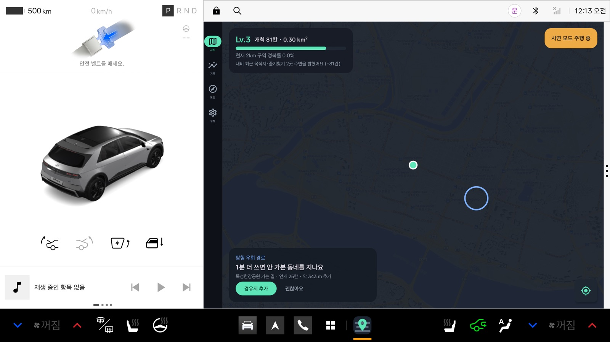
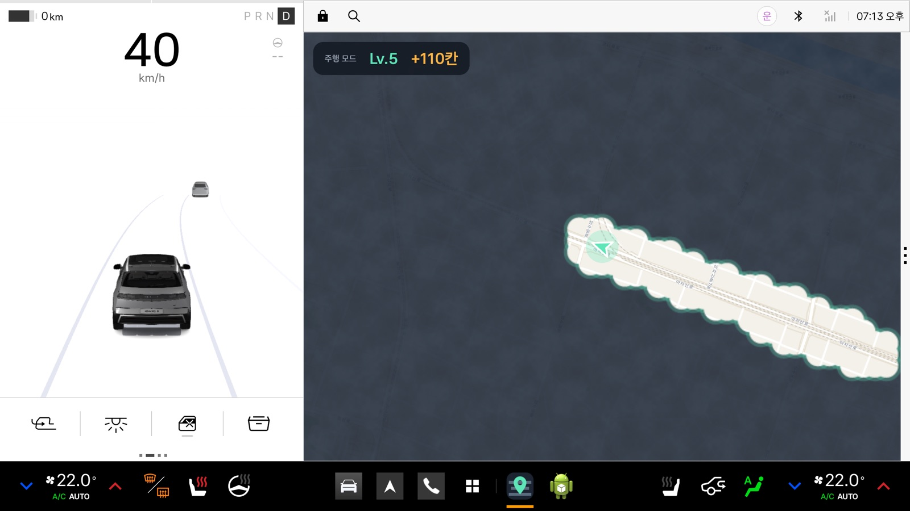
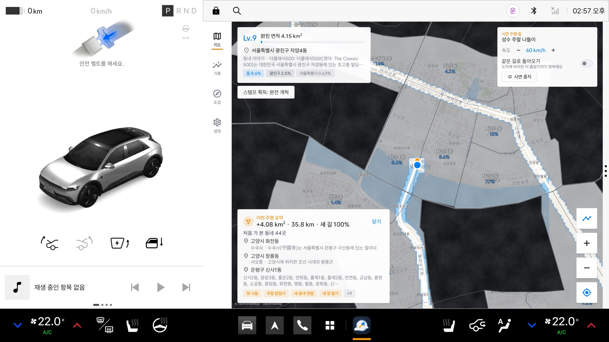
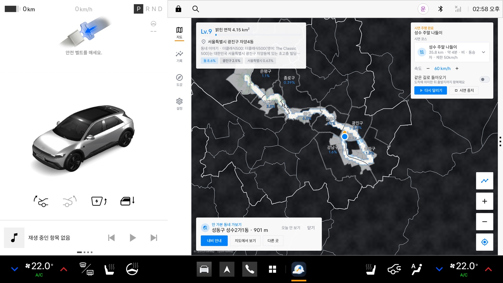
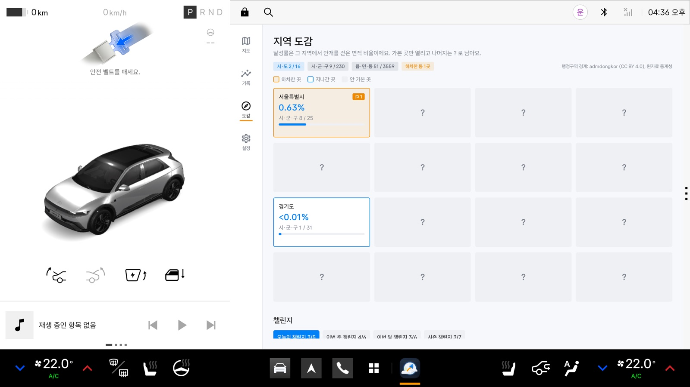
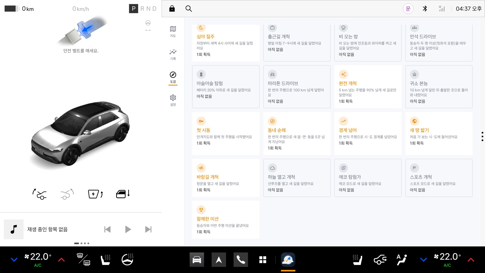

# 02 앱 프로젝트 소개 / 심사 자료 원고

접수양식 「02 앱 프로젝트 소개 / 심사 자료」 1–8번 칸에 들어갈 원고입니다. [`application-form.docx`](application-form.docx)에 이미 같은 내용이 채워져 있으며, 고칠 때는 이 파일을 고친 뒤 `python3 tools/submission/build_form.py`로 양식을 다시 만듭니다.

- 기준일: 2026-10-25 (앱 v0.1.0, 저장소 `main`)
- 작성 규칙: 성명·연락처·이메일·소속·계정정보·개발자 실명을 쓰지 않습니다(양식 02 안내). 팀은 팀명 **zobo**로만 표기합니다.
- `【기입 필요: …】` 표시는 제출 전에 채워야 하는 곳입니다.

---

## 1. 앱 한 줄 소개

시동만 걸면 달린 길의 안개가 걷히고, 아직 안 가 본 동네는 안개로 남는 차량 전용 탐험 지도 「안개지도(FogDrive)」입니다.

## 2. 기획 배경

운전자는 매일 같은 길을 오가고, 어디를 달려 봤는지는 기억에만 남습니다. 안개지도는 이 이동 기록을 '지도를 밝히는 게임'으로 바꿔, 익숙한 길 밖으로 한 번 더 나가게 만듭니다.

**기존 휴대폰 앱의 한계**

- 안개 지도 개념은 Fog of World가 2012년부터 휴대폰에서 제공해 왔고, 탐험 게임으로서의 수요는 검증됐습니다.
- 하지만 휴대폰 앱은 백그라운드 위치 기록을 계속 켜 둬야 해서 배터리 부담이 크고, 앱이 꺼지면 기록이 끊깁니다.
- 휴대폰은 지나간 길과 실제로 내려서 머문 곳을 구분하지 못하고, 비·야간·동승자 같은 주행 상황도 알지 못합니다.

**차량에서 해야 하는 이유**

- 차는 시동과 함께 켜지고 전원 걱정이 없어, 따로 실행하지 않아도 기록이 끊기지 않습니다.
- 기어(P단)·도어·좌석·와이퍼·전조등·창문 신호로 '어디를 지났는지'뿐 아니라 '어디에 내렸고, 어떤 상황이었는지'까지 기록할 수 있습니다.
- 내비와 연동해 안개 낀 동네를 경유지로 넣어, 기록을 넘어 새로운 이동을 직접 만들어 냅니다.

## 3. 앱 주요 기능 및 차량 특화 요소

핵심은 시동과 함께 도는 자동 기록과 행정구역 단위 지역 도감입니다. 모든 기능은 Pleos Connect 에뮬레이터 v2.1.0에서 실제 SDK로 동작합니다.

| 기능 | 내용 | 사용 데이터 | 차량 특화 |
| --- | --- | --- | --- |
| 자동 안개 걷기 | 주행 경로를 약 30m 격자로 기록해 도로와 눈에 보이는 범위(도로 양쪽 약 45m)만 걷음. 같은 길을 다시 달린 횟수도 기록 | Pleos FusedLocation (미지원 차량은 Android GPS) | 시동과 함께 자동 기록 |
| 2단계 안개 · 지역 도감 | 안 가 본 읍·면·동은 짙은 안개, 들어가 본 동의 안 지난 곳은 옅은 안개. 시·도 → 시·군·구 → 읍·면·동 달성률 | 위치 + 행정구역 경계(통계청 원자료) | - |
| 하차 지점 | P단 전환 후 도어가 열린 곳 주변(약 210m)을 걷고 핀 표시 | AAOS 기어, Vehicle Door | 지나간 곳과 머문 곳을 구분 |
| 첫 실행 지도 채우기 | 내비 최근 목적지·즐겨찾기 주변을 미리 걷어 빈 지도로 시작하지 않음 | NaviHelper 최근 목적지·즐겨찾기 | 설치 첫날부터 동기 부여 |
| 탐험 우회 경로 | 출발 전 "1분 더 쓰면 안 가 본 동네를 지나요" 제안 → 경유지 추가. 주행 가능 거리로 왕복이 어려운 제안은 거름 | NaviHelper 목적지·경유지, Vehicle Odometer | 기록을 넘어 새 이동을 유도 |
| 도착 · 안 가 본 동네 추천 | 목적지·경유지 도착 시 주변을 걷고 스탬프, 가장 가까운 미탐험 동을 카드로 제안해 내비 안내 | NaviHelper 경로 안내 상태·경로 요청 | 내비와 한 흐름 |
| 상황 스탬프 29종 | 빗속 개척, 야간 개척, 가족 탐험, 충전소 깃발, 바람길 개척, 하늘 열고 개척, 에코·스포츠 모드 등 | 와이퍼, 전조등, 좌석, EV 배터리, 창문, 선루프, 주행 모드 | 휴대폰이 모르는 주행 상황 |
| 주행 모드 | 주행 중에는 지도·현재 위치·레벨·회전 안내·제한속도만. 탭·기록·도감은 정차 중에만 | CarUxRestrictions | 운전 중 조작 최소화 |
| 음성 안내 · 주행 요약 | 처음 들어선 동네와 동네 개척률 단계(50% 이상)를 짧게 말하고, 하차하면 밝힌 면적·거리·새 길 비율·처음 가 본 동네를 카드로 | Pleos TextToSpeech, 앱 내부 계산 | 화면을 보지 않아도 성과를 앎 |
| 동승자 미션 | 조수석·뒷좌석에 동승자가 있으면 주행마다 미션 하나(새 동 2곳 등) | Vehicle Seat | 함께 탄 사람의 재미 |
| 동네 이야기 | 처음 가 본 동의 명소를 한 줄로 소개(동 중심 좌표만 전송) | 위키백과 API | 이동이 곧 지역 탐방 |

**게임 요소**

- 레벨: 밝힌 칸과 새 스탬프로 경험치, 하루 2 km² ≈ Lv.6, 시즌 15 km² ≈ Lv.13
- 챌린지: 오늘 / 이번 주 / 이번 달 / 시즌(3개월) 탭별 5–7개 목표
- 지역 도감: 한 칸이라도 지난 지역만 열리고 나머지는 "?"
- 자주 다닌 길: 반복 횟수에 따라 2회 파랑 → 50회 빨강으로 색이 바뀜
- 내 안개지도 카드: 개척한 곳을 그린 공유용 이미지(PNG)

## 4. 주요 사용 시나리오

주말 가족 나들이 한 번으로 기록 → 정차 후 확인 → 다음 탐험 제안까지 이어지는 흐름입니다.

1. **출발 전 (P단):** 운전자가 내비에 목적지를 설정하자 앱이 "1분 더 쓰면 안 가 본 동네를 지나요"라고 제안합니다. 누르면 경유지로 추가됩니다.
2. **주행 중:** 화면 조작 없이 경로가 기록되고, 주행 화면에는 지도·회전 안내·제한속도만 보입니다. 비가 와서 와이퍼가 켜지고 뒷좌석에 아이가 탄 상태로 새 동네에 들어서면 처음 들어선 동네 이름을 음성으로 짧게 알려 줍니다.
3. **도착 (P단 + 도어 열림):** 이곳이 하차 지점으로 기록되고 주변 안개가 넓게 걷힙니다. 이번 주행 요약 카드에 밝힌 면적·거리·새 길 비율, 처음 가 본 동네와 그 동네 이야기, '빗속 개척'·'가족 탐험' 스탬프와 동승자 미션 결과가 나옵니다.
4. **정차 중 지도 확인:** 지역 도감에서 "광진구 2.5%"처럼 달성률이 오른 것을 보고, 가장 가까운 안 가 본 동네 추천 카드를 누르면 내비가 안내를 시작합니다.
5. **다음 주행:** 이번 주 챌린지 진행률(새 동 2/3 등)이 다음 탐험을 유도합니다.

## 5. 개발 계획

핵심 기능은 이미 구현했고, 에뮬레이터에서 실제 SDK 경로로 자동 검증하고 있습니다. 준비 중인 SDK는 공개되는 대로 대체 구현 자리만 바꿉니다.

**SDK/API 사용 현황**

| 구분 | SDK / API | 용도 | 상태 |
| --- | --- | --- | --- |
| 위치 | Pleos FusedLocation 1.1.3 (`isSupported()` 미지원 시 Android GPS) | 주행 경로 기록 | 구현 |
| 기어 | AAOS `CarPropertyManager` `GEAR_SELECTION` | P단 판별, 하차 지점 | 구현 |
| 도어·좌석 | Vehicle 2.3.2 Door, Seat | 하차 지점, 가족 탐험, 동승자 미션 | 구현 |
| 주행 상황 | Vehicle Wiper, Light, EvBattery, Window, Sunroof, DrivingMode | 상황 스탬프 | 구현 |
| 주행거리 | Vehicle Odometer (누적 거리, `RangeRemaining`) | 개척 지표, 우회 경로 거르기 | 구현 |
| 내비 연동 | NaviHelper 3.0.5 최근 목적지·즐겨찾기, `getDestinationInfo`, `addWaypoint`, `requestRoute`, 경로 안내 상태 | 첫 실행 지도 채우기, 우회 경로, 동네 추천, 도착·회전 안내 | 구현 |
| 주행 규제 | AAOS `CarUxRestrictionsManager` | 주행 모드 전환 | 구현 |
| 음성 | Pleos TextToSpeech 3.3.1 (온디바이스 합성, 내비 안내 오디오) | 새 동네·스탬프·도착·요약 음성 | 구현 |
| 동기화 | 기기 내 보낼 함(outbox) 대체 구현 | 백업·클라우드 동기화 | Pleos Sync SDK 공개 시 교체 |

**Pleos Connect 구현 범위**

- 기록: 포그라운드 서비스가 맡아 화면이 꺼져 있어도 계속됩니다. 위치 기록은 기기 내부(Room DB)에만 저장하고, 기록 전체 삭제를 지원합니다.
- 지도: 외부 앱용 지도 SDK가 없어 MapLibre + OpenFreeMap(OpenStreetMap) 타일에 전용 주간·야간 스타일을 만들어 그립니다. 출처 표기를 유지합니다.
- 성능: 주행 모드는 미리 넓게 그린 지도를 밀어서 움직여, 에뮬레이터에서 CPU 3.6%(40km/h)·6.2%(100km/h), 메모리 약 160MB입니다(Pleos 권장: 지도 앱 CPU 15%, RAM 400MB 이내).
- 검증: 단위 테스트 69개, 에뮬레이터 자동 테스트 21개(Virtual Console로 기어·도어·와이퍼·좌석 등 신호 주입, UIAutomator로 화면 판독).
- 시연: 서울·수도권·부산·강릉 실제 도로 코스 17개를 20–200km/h로 재생하는 시연 모드를 앱에 넣어, 출발 → 주행 → 하차까지 한 번에 보여 줍니다.

**로드맵**

1. 1차 접수(11/15): 접수양식 + 시연 영상 + GitHub 저장소(소스·release APK)
2. 2차 PT(12/3–4): 에뮬레이터에서 실동작 시연(자동 기록, 하차 지점, 지역 도감, 상황 스탬프, 탐험 우회 경로, 주행 요약)
3. 이후: Pleos Sync SDK가 공개되면 동기화 교체, 실차에서 음성 안내 빈도·톤 점검

## 6. 기대효과 및 발전 가능성

주말 나들이와 여행이 잦은 운전자를 중심으로, 시동만 걸면 쌓이는 기록과 기간별 챌린지로 매주 다시 여는 탐험 앱을 목표로 합니다.

**타깃 고객**

| 세그먼트 | 특징 | 핵심 가치 |
| --- | --- | --- |
| 주말 나들이 가족 | 아이와 근교 이동이 잦음 | 가족 탐험 스탬프, 동승자 미션, 공유 카드 |
| 드라이브·여행 애호가 | 새 길과 지역 방문 자체를 즐김 | 지역 도감, 레벨, 시즌 챌린지 |
| 출퇴근 위주 운전자 | 같은 길만 반복 | 탐험 우회 경로로 작은 변화, 자주 다닌 길 기록 |

**시장 근거**

- Pleos Connect는 2026년 5월 '더 뉴 그랜저'부터 적용되어 2030년까지 전 세계 약 2,000만 대 탑재가 목표입니다.
- 탑재 차종 판매: 더 뉴 그랜저와 디 올 뉴 아반떼(8월 계약 시작, 전 트림 Pleos Connect 기본)는 2026년 9월 한 달에만 국내에서 각각 8,898대·7,305대가 팔렸습니다. 6·8·9월 그랜저와 9월 아반떼 공식 판매만 더해도 약 3.2만 대이고, 지금 속도(월 약 1.6만 대)라면 2027년 말 국내 탑재 차량은 약 30만 대입니다(현대차 월간 판매 실적).
- 국내 신차 판매는 현대차 71.3만 대 + 기아 54.6만 대 ≈ 연 126만 대(2025)입니다.
- 국내여행 이동수단의 84.5%가 자동차이고(2025 국민여행조사), 비사업용 차량은 하루 평균 30.8km를 달립니다(한국교통안전공단, 2025).

**예상 MAU (가정)**

MAU = 국내 Pleos 탑재 누적 차량(V) × 앱 설치율(I) × 월간 활성률(A). 활성률은 일반 앱 30일 리텐션(3–7%)보다 높게 잡았습니다. 차량 앱은 설치 후 따로 실행하지 않아도 시동 때마다 기록이 돌기 때문입니다. V는 보수 = 그랜저·아반떼 두 차종의 지금 판매 속도, 기본 = 투싼 등 신차 추가, 낙관 = 기아·제네시스까지 확대를 가정했습니다.

| 시나리오 | V (2027년 말) | I | A | MAU |
| --- | --- | --- | --- | --- |
| 보수 | 30만 대 | 2% | 30% | 약 1,800 |
| 기본 | 50만 대 | 5% | 40% | 약 1만 |
| 낙관 | 80만 대 | 10% | 50% | 약 4만 |

**Retention 설계와 지표**

- 자동 기록: 앱을 열지 않아도 데이터가 쌓여 다음에 열 이유가 생김 → 주간 주행 리텐션(W1/W4/W12) 추적
- 기간별 챌린지·스탬프 29종·레벨: Duolingo 7일 스트릭 도달 사용자의 완주 가능성 3.6배 사례 → 챌린지 완료율, 연속 달성 주차
- 지역 도감·안 가 본 동네 추천·동네 이야기 → 월 신규 개척 읍·면·동 수
- 주행 요약·음성 안내 → 주행 1회당 가치 체감, 요약 조회율
- 벤치마크: 전체 앱 D30 7%, 여행 앱 D30 3–4%(Adjust)

**향후 서비스 확대 계획**

- 지자체·관광공사 제휴: 지역 스탬프 투어를 앱 도감으로 제공(인천e지 스탬프투어 협업 36건 선례)
- 명소·제휴 매장 연계: 하차 지점 주변 혜택 노출(Pleos 결제·구독 도구 공개 시)
- 해외 확대: 행정구역 경계 데이터만 바꾸면 국가별 정복 지도로 확장
- Pleos Sync 연동: 같은 계정의 여러 차량 기록을 하나의 지도로

## 7. 참고자료

- GitHub 저장소: https://github.com/TEAM-zobo/fogdrive (비공개, 심사용 계정을 읽기 권한으로 초대)
- Release APK: 저장소 `apk/zobo_FogDrive_release.apk` (v0.1.0, minSdk 28, arm64-v8a·x86_64)
- 시연 영상: 【기입 필요: 시연 영상 링크】
- 실행 방법: 저장소 `README.md`, 테스트 환경 셋팅 `docs/SETUP.md` (Pleos Connect Emulator v2.1.0)
- 앱 화면

## 8. 숏폼 링크

【기입 필요: 숏폼 링크 — 선택. 게시하지 않으면 "없음"】
