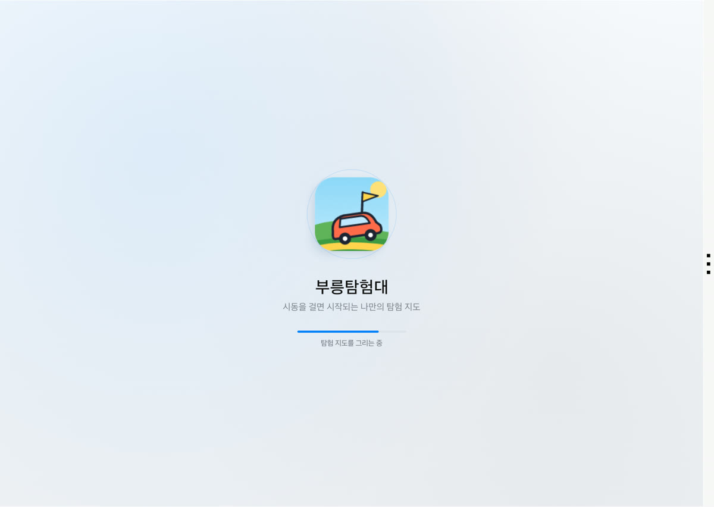
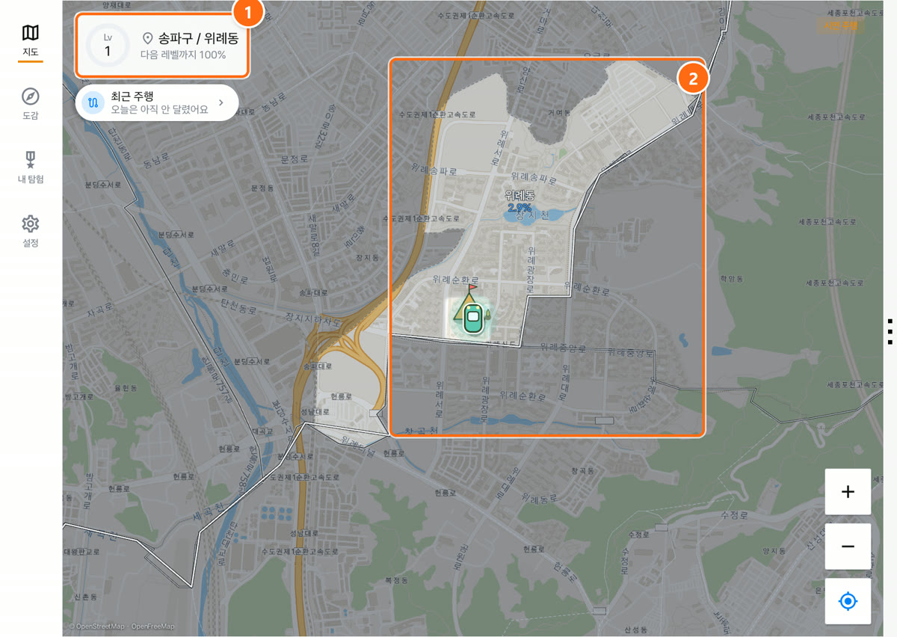
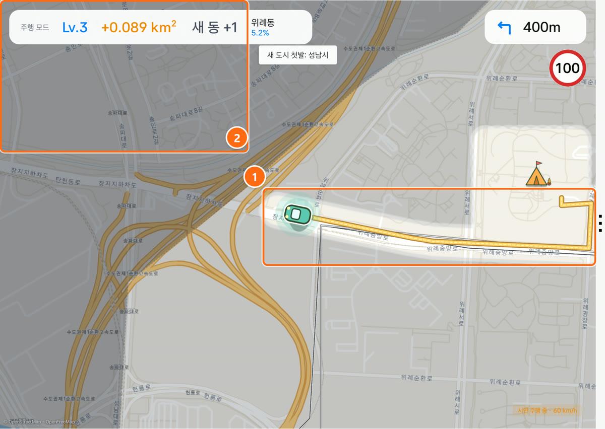
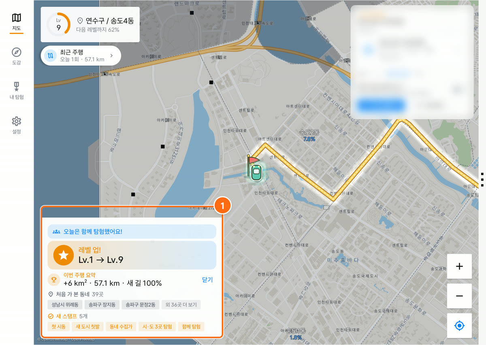
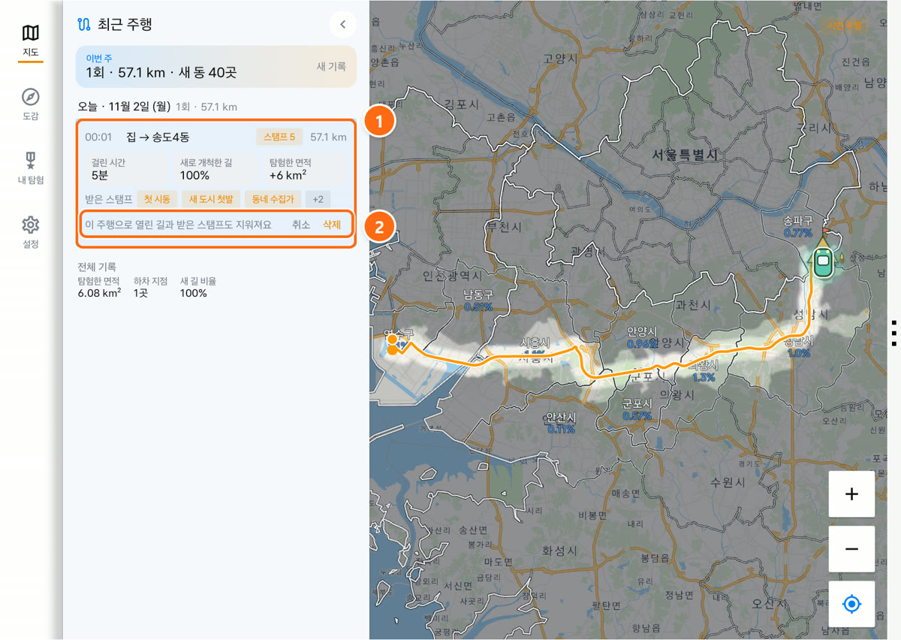
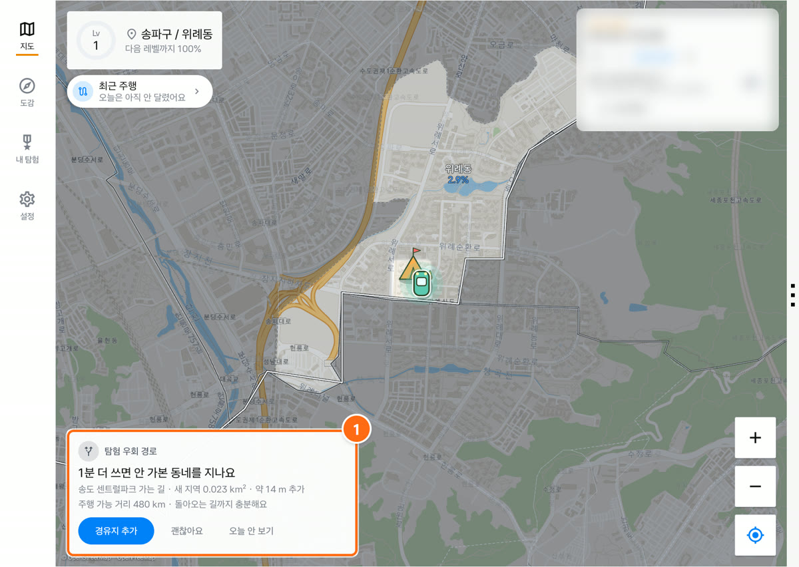
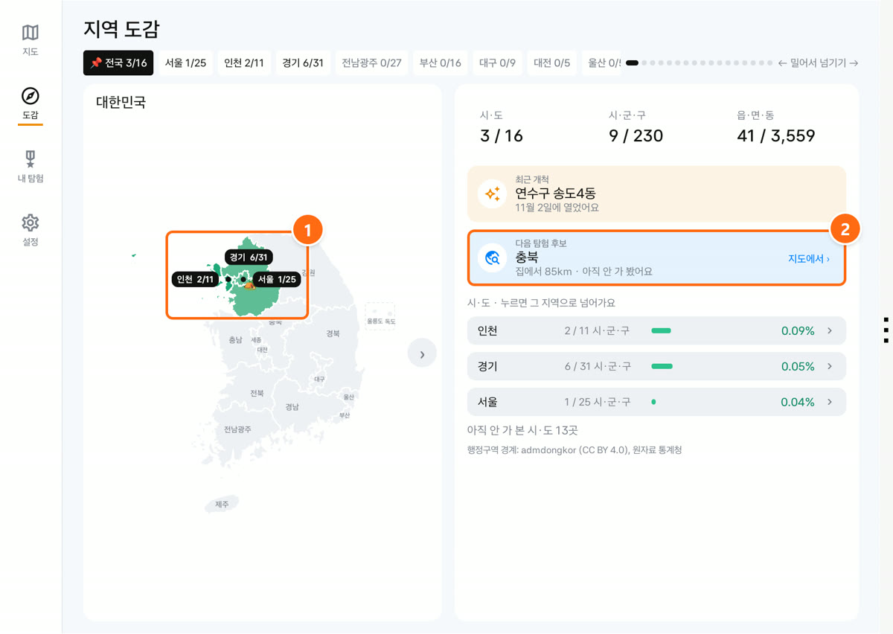
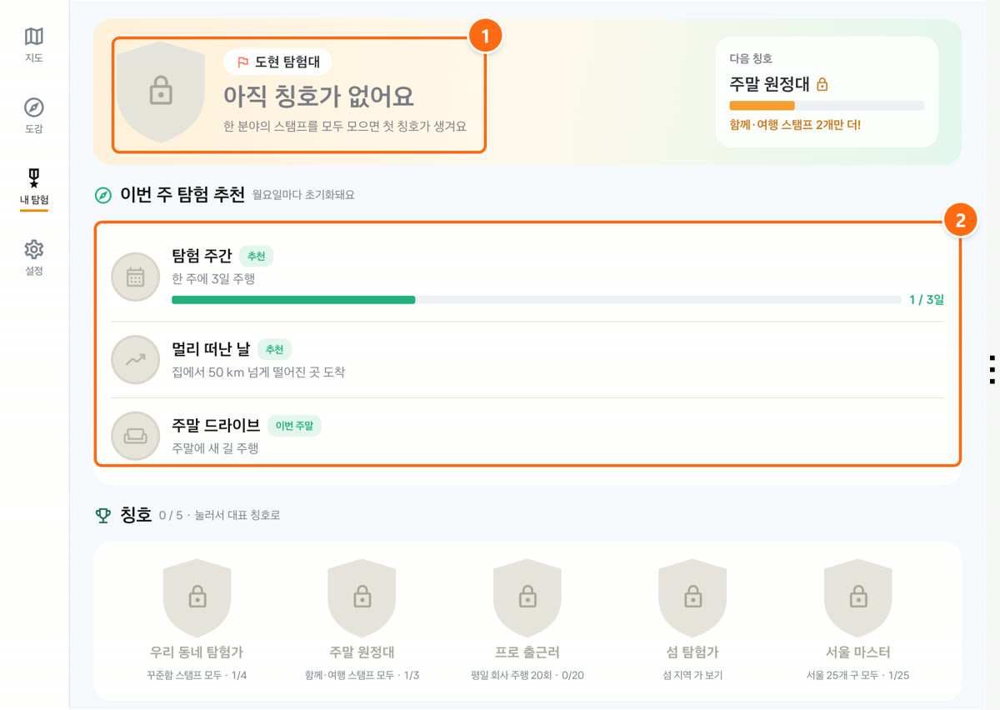
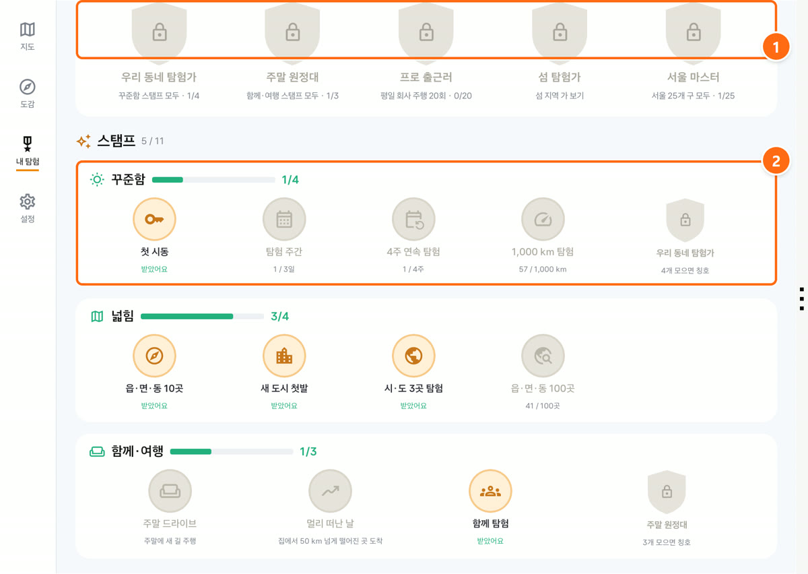
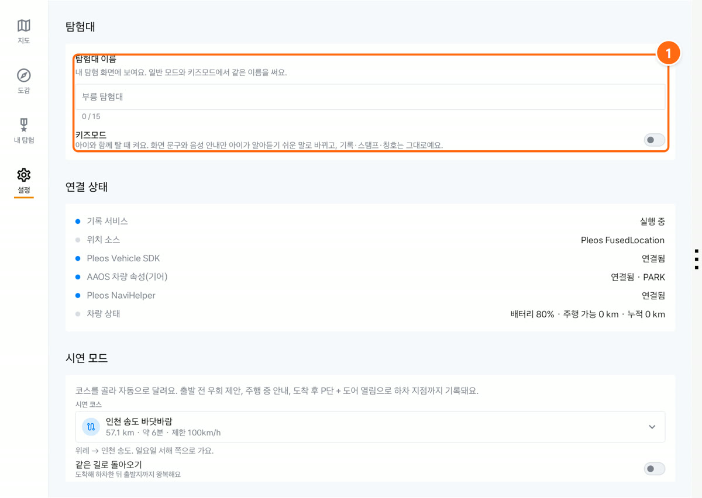

# 02 앱 프로젝트 소개 / 심사 자료 원고 — 부릉탐험대

접수양식 「02 앱 프로젝트 소개 / 심사 자료」 1–8번 칸에 들어갈 원고입니다. 제출 저장소 `main` 브랜치의 부릉탐험대 앱을 기준으로 씁니다. 고친 뒤 `python3 tools/submission/build_form.py`로 `application-form.docx`를 다시 만듭니다.

> **2026-11-02:** 이 원고는 Word에서 직접 고친 [`application-form.docx`](application-form.docx)(11/02본)의 02 내용에 맞췄습니다. 다만 스크립트는 Word의 표 안 상자·형광펜·화면 표 배치를 그대로 재현하지 못하고, 01 참가 정보도 `private/team.json`에서만 채웁니다. 지금 docx를 계속 쓸 거라면 `build_form.py`를 실행하지 말고 docx와 이 원고를 함께 고칩니다.

- 기준일: 2026-11-02 (브랜치 `main`, 패키지 `com.zobo.burung`)
- 작성 규칙: 성명·연락처·이메일·소속·계정정보·개발자 실명을 쓰지 않습니다(양식 02 안내). 팀은 팀명 **zobo**로만 표기합니다.
- `【기입 필요: …】` 표시는 제출 전에 채워야 하는 곳입니다.
- 앱 화면 이미지는 `../images/burung/form/`에 있습니다(docx에 들어간 10장).

---

## 1. 앱 한 줄 소개

**「부릉탐험대」는 주행이 기록이 되고, 기록이 탐험이 되는 차량 전용 앱 서비스입니다.**

## 2. 기획 배경

**문제: “매일 운전하지만 운전이 남기는 것이 없다”**

- 운전은 일상입니다. 대한민국 운전자는 하루 평균 30.8 km를 달립니다. * 한국교통안전공단, 2025 (비상업용 자동차 기준)
- 여행도 차로 갑니다. 국내 여행 이동수단의 84.5%가 승용차입니다. * 2025 국민여행조사
- 그러나 이 많은 주행은 내비게이션 안내가 끝나면 아무것도 남기지 않습니다. 운전자의 기억에 어렴풋이 남을 뿐입니다. 동승한 가족, 특히 아이에게 차 안의 시간은 목적지까지 기다리는 시간일 뿐입니다.

**기존 서비스의 한계: 왜 차량 앱이어야 할까?**

- 탐험 지도는 매일의 이동이 빠짐없이, 꾸준히 쌓일 때 가치가 생깁니다. 출퇴근길, 주말 근교 드라이브 한번이 모여야 ‘내가 개척한 지도’가 됩니다.
- 이동을 지도에 기록하는 모바일 앱은 마켓에 다수 출시되어 있지만, 모바일 기기로는 ‘빠짐없이, 꾸준한 기록’이 지켜지기 어렵습니다.
    - **배터리 부담:** 백그라운드에서도 앱을 실행해야 하므로 배터리 소모가 큽니다.
    - **잦은 끊김:** OS가 백그라운드 앱을 닫거나 (iOS에서 자주 발생) 사용자가 앱을 끄면 기록이 누락됩니다.
    - **관리 부담:** 기록이 이어지는지 확인하려고 앱을 주기적으로 실행시켜야 하는 부담이 생깁니다.
- 차량 앱의 경우 신경 쓰지 않아도 빠짐없이, 정확하고 꾸준한 기록이 가능합니다.
    - Pleos SDK로부터 정확한 주행 및 차량 데이터를 받아 기록합니다.
    - 현대차 내비게이션에 저장된 집·회사·즐겨찾는 장소 데이터를 받아 주행의 맥락을 반영합니다.

## 3. 앱 주요 기능 및 차량 특화 요소

### 앱 주요 기능

**주행 기록**

- 시동이 걸리면 앱을 열지 않아도 기록이 시작됩니다.
- 앱을 띄워 둔 상태라면 주행 중 지도에 탐험 경로가 실시간으로 그려집니다.
- 아직 가 보지 않은 동네는 어둡게 덮여 있고, 차가 지나간 길만 밝게 표시됩니다.
- P단 전환 후 도어가 열린 곳 주변은 넓은 범위로 밝혀지고, 도착 깃발이 표시됩니다.

| Pleos SDK·차량 데이터 |
| --- |
| · 시동 연동: Android BOOT_COMPLETED로 차량 부팅(시동) 때 기록 서비스 자동 시작, 차량 전원으로 상시 동작 |
| · 주행 위치: Pleos FusedLocation registerFusedLocationCallback → LocationData(위도·경도·정확도·시각) |
| · 하차 지점: 기어 P단(AAOS GEAR_SELECTION) + Pleos Vehicle Door 열림 → 도착 깃발, 주변을 넓게 밝힘 |
| · 즐겨찾는 장소: Pleos NaviHelper getBookmarkInfo(집·회사·즐겨찾기) |

**주행 제안**

- 기록을 바탕으로 가 보지 않은 지역을 추천하고, 현대차 내비게이션으로 경로를 요청합니다.
- 내비게이션 목적지가 설정되면 출발 전 “1분 더 쓰면 안 가 본 동네를 지나요” 같은 우회 경유지를 제안합니다.
- 지역 도감에서 16개 시·도 → 시·군·구 → 읍·면·동 개척률과 ‘다음 탐험 지역’을 제안합니다.
- 주행 기록과 획득한 스탬프를 바탕으로 주간 탐험(주행)을 추천합니다.

| Pleos SDK·차량 데이터 |
| --- |
| · 기준점(베이스캠프): Pleos NaviHelper getBookmarkInfo → BookmarkType.HOME(집) |
| · 현재 목적지: getDestinationInfo, onDestinationChanged |
| · 길 안내 연결: requestRoute(탐험지로 경로 요청), addWaypoint(우회 경유지 추가) |
| · 무리한 제안 거르기: Pleos Vehicle Odometer.registerRangeRemainingListener (주행 가능 거리) |

**레벨·스탬프·칭호 시스템**

- 주행 거리에 따라 레벨이 올라갑니다.
- 주행 데이터에 따라 스탬프를 획득하고, 보유한 스탬프에 따라 칭호를 획득합니다.

| Pleos SDK·차량 데이터 |
| --- |
| · Pleos Vehicle Seat 데이터 — 사용 예시: 주행 중 동승자 착석 데이터가 있다면 ‘함께 탐험’ 스탬프 획득 |
| · Pleos NaviHelper getBookmarkInfo — 사용 예시: 내비게이션에 저장된 집 위치에서 50 km 넘게 떨어진 곳에서 하차 시 ‘멀리 떠난 날’ 스탬프 획득 |
| · 주행 날짜·거리·지역: FusedLocation 위치와 시각 |

**키즈모드**

- 설정을 통해 키즈모드로 전환할 수 있습니다.
- 키즈모드 설정 시 음성 안내·앱 화면이 함께 탄 아이에 맞추어 변경됩니다.
- 키즈모드는 언제든 ON/OFF 할 수 있습니다.

| Pleos SDK·차량 데이터 |
| --- |
| · Pleos TextToSpeech Mode.ON_DEVICE, speak — 사용 예시: 키즈모드에서는 새 동네에 들어설 때 “짜잔! 처음 와 보는 ○○동이에요!”, 레벨이 오르면 “우와, 탐험대가 5레벨이 되었어요!”처럼 아이 눈높이 말투로 안내합니다. |

**안전 운전·개인정보 보호**

- **출발 전(P단):** 탐험지 추천과 우회 경유지 제안은 정차 중에만 보이고, 주행 가능 거리로 무리한 제안을 거릅니다.
- **주행 중:** 앱을 조작할 수 없고 주행 위치를 나타내는 지도와 짧은 정보만 보입니다. 처음 들어선 동네만 짧은 음성으로 알려 줍니다.
- **도착(P단+도어):** 주행 결과와 레벨 업은 차가 서고 문이 열린 뒤 화면과 음성으로 알려 줍니다.
- 주행 기록은 운전자가 언제든 삭제할 수 있습니다.

### 차량 내 새로운 사용자 경험

**1. 운전이 ‘나만의 탐험 지도’가 됩니다**

**지금까지 운전은 목적지에 도착하면 끝나고 아무것도 남지 않았습니다.**
부릉탐험대를 통해 매일의 출퇴근이, 주말의 근교 드라이브가 도감으로 쌓여 내가 넓혀 온 세계를 한눈에 볼 수 있습니다.

**2. 새로운 지역으로의 주행을 경험합니다**

**지금까지는 늘 가던 길, 늘 가던 곳을 오가는 운전이 대부분이었습니다.**
부릉탐험대는 나만의 운전 기록을 바탕으로 아직 가 보지 않은 동네와 이번 주 탐험을 제안합니다. 목적지가 있을 때는 조금만 돌아가면 안 가 본 동네를 지나는 길을 알려 줍니다.
제안을 누르면 바로 현대차 내비게이션 안내로 이어져, 생각하지 못했던 지역으로의 주행을 자연스럽게 경험하게 됩니다.

**3. 함께 탄 가족도 탐험대원이 됩니다**

**지금까지 동승자는 목적지에 도착하기를 기다리는 사람이었습니다.**
부릉탐험대에서는 동승자도 탐험대원으로서 주행 경험에 함께합니다.
함께 달린 날은 ‘오늘은 함께 탐험했어요!’로 남고, 우리 탐험대 이름으로 가족의 기록이 쌓입니다. 아이와 탈 때는 키즈모드로 처음 가 본 동네와 레벨 업 소식을 아이 눈높이의 말투로 들려주고, 도착하면 오늘 함께 밝힌 길과 받은 스탬프를 아이와 같이 봅니다.

## 4. 주요 사용 시나리오

**40대 초반 아이 아빠 A씨**

- **평일:** 아침에 유치원생 아이를 등원시킨 뒤 출근, 왕복 20 km
- **주말:** 매주 토요일, 가족과 근처 공원 나들이
- **분기 1회:** 강원도 1박 2일 가족 여행
- **기대:** 매일 아이와 함께하는 차 안 시간과 가족 나들이를 함께 남기고 싶음

**① 평일 아침 등원 + 출근: 아이와 함께하는 하루의 시작**

| 상황 | A씨 | 부릉탐험대 |
| --- | --- | --- |
| 주행 | 아이와 차량 탑승 후 주행 | 키즈모드 ON 상태로, 아이 눈높이로 음성/문구 안내 |
| 유치원 도착 (P단+도어 열림) | 아이를 내려줌 | 유치원에 하차 깃발, ‘함께 탐험’ 스탬프 획득 |
| 회사 도착 | 하차 | 20번째 출근으로 ‘프로 출근러’ 칭호 획득 |

**② 토요일 공원 나들이: 가족의 주말 기록**

| 상황 | A씨 | 부릉탐험대 |
| --- | --- | --- |
| 출발 전 (P단) | 이번 주는 안 가 본 곳을 가기로 함 | 도감의 ‘다음 탐험 지역’과 이번 주 추천 주행을 참고하여 아이와 목적지 설정 |
| 주행 | 주행 | 키즈모드 ON 상태로, 키즈모드 음성 안내: “짜잔! 처음 와 보는 ○○동이에요!” |
| 공원 도착 | 하차 | ‘주말 드라이브’ 스탬프 획득 |

## 5. 개발 계획

### 구현 현황

핵심 기능은 모두 구현했고, Pleos Connect 에뮬레이터 v2.1.0에서 실제 SDK로 동작합니다.

**SDK/API 사용 현황**

| 구분 | SDK / API | 용도 | 상태 |
| --- | --- | --- | --- |
| 위치 | Pleos FusedLocation 1.1.3 (미지원 차량은 Android GPS) | 주행 위치·경로 기록 | 구현 |
| 기어 | AAOS CarPropertyManager GEAR_SELECTION | P단 판별, 하차 지점, 도착 결산 | 구현 |
| 도어·좌석 | Vehicle 2.3.2 Door, Seat(점유) | 하차 지점, 함께 탐험 | 구현 |
| 주행 상황 | Vehicle Wiper, Light, EvBattery, DrivingMode | 차량 상태 표시(연결 상태). 위험한 운전을 보상하지 않도록 빗길·야간·저배터리·스포츠 모드로 받는 스탬프는 일부러 없앰 | 구현 |
| 주행거리 | Vehicle Odometer, RangeRemaining | 우회 경로 거르기 | 구현 |
| 내비 연동 | NaviHelper 3.0.5 즐겨찾기(getBookmarkInfo: 집·회사·장소), getDestinationInfo, addWaypoint, requestRoute, 경로 안내 상태 | 베이스캠프, 목적지 깃발, 우회 경유지, 탐험지 안내, 도착 판정 | 구현 |
| 주행 규제 | AAOS CarUxRestrictionsManager | 주행 모드 전환 | 구현 |
| 음성 | Pleos TextToSpeech 3.3.1 (온디바이스) | 새 동네·도착 요약·레벨업 음성, 키즈모드 말투 | 구현 |
| 동기화 | 기기 내 보낼 함(outbox) 대체 구현 | 백업·클라우드 동기화 | Pleos Sync SDK 공개 시 교체 |

**구현 방식**

- **기록**
  - 시동(부팅)과 함께 포그라운드 서비스가 자동으로 시작되어, 화면을 보지 않아도 계속 기록합니다.
  - 기록은 차량 기기 안(Room DB)에만 저장하고, 기록 전체 삭제를 지원합니다.
- **지도**
  - 외부 앱용 지도 SDK가 없어 MapLibre와 OpenFreeMap(OpenStreetMap) 타일을 그대로 씁니다.
  - 그 위에 개척 레이어(어두운 막·개척로·깃발·텐트)만 따로 그리고, 지도 이미지 자체는 바꾸지 않습니다.
- **지역 도감**
  - 행정구역 경계(admdongkor 2026-10-01판, CC BY 4.0, 원자료 통계청)를 앱에 넣어 오프라인으로 개척률을 계산합니다.
  - 도감의 대한민국·시·도 지도도 이 경계로 직접 그립니다.
  - 전국 지도는 한 화면에 들어가도록 울릉도·독도를 경북 앞바다의 점선 상자에, 제주를 위도 0.3° 북쪽에 그립니다(경계 모양은 그대로).
- **검증**
  - 단위 테스트와 에뮬레이터 자동 테스트(Virtual Console로 기어·도어·와이퍼·좌석 신호 주입)로 확인합니다.
  - 실제 도로 코스를 재생하는 시연 모드: 시연 페르소나 A씨의 평일 등원·출근, 토요일 가족 나들이·장보기, 강원도 가족 여행 등 14개 코스
- **시연 데이터**
  - 4장의 40대 아빠 A씨를 가정해 만든 가상의 4주 주행 기록(앱을 쓰기 시작한 뒤 혼자 출퇴근한 19일: 주행 38건, 462 km)을 넣습니다.
  - 아이 등원과 토요일 공원 나들이는 시연에서 처음 달려, 4장 표의 스탬프·칭호(‘함께 탐험’, 「프로 출근러」, ‘주말 드라이브’)가 그대로 나옵니다.
  - 실제 주행 데이터가 아니며, 주행 거리는 국내 자동차 하루 평균 주행거리를 참고해 정했습니다(38.7 km, 한국교통안전공단, 2024).
  - 집·회사·즐겨찾기는 에뮬레이터의 현대차 내비게이션에 저장하고, 앱은 Pleos API로 읽습니다.

### 운영·예외 설계

| 질문 | 설계 |
| --- | --- |
| 네트워크가 끊기면 기록은? | • 위치·경로·개척·스탬프·레벨은 모두 기기 안에서 계산·저장하므로 그대로 기록됩니다. • 행정구역 데이터와 음성 합성도 기기 안에 있습니다. • 네트워크가 필요한 것은 지도 배경 타일뿐입니다. • 백업은 기기 안에 저장하고, 클라우드 동기화는 Pleos Sync SDK가 공개되면 연결합니다. |
| 주행 중 위험 요소는? | • 주행 중에는 차량 주행 규제에 따라 지도·현재 위치·짧은 숫자만 보이고, 탭·카드·추천은 정차 중에만 열립니다. • 결산과 레벨업 축하는 도착 후에만 보여 주고, 성과 알림은 짧은 음성으로만 합니다. • 빗길·야간·심야·저배터리·스포츠 모드·장시간 연속 주행으로 받는 스탬프는 일부러 없애, 보상이 위험한 운전을 부추기지 않습니다. • 경유지 제안은 출발 전 P단에서만 하고, 주행 가능 거리로 무리한 제안을 거릅니다. |
| 차를 바꾸면 기록은? | • 지금은 기록을 파일로 내보내 새 차에서 불러옵니다. • Pleos Sync SDK가 공개되면 계정 단위로 동기화합니다. • 한 차를 여러 사람이 쓰면 운전자 프로필마다 기록이 따로 쌓입니다. |
| 앱을 한동안 안 열면? | • 시동이 걸릴 때마다 기록이 자동으로 이어져, 오랜만에 열어도 그동안 달린 길과 경험치·스탬프가 모두 반영돼 있습니다. • 앱을 열지 않아도 주행 중에는 처음 들어선 동네를, 도착하면 주행 요약과 레벨 업을 짧은 음성으로 알려 줍니다. • 이번 주 탐험 추천이 월요일마다 바뀌어 다시 열 이유를 만듭니다. • 기록은 사용자가 지우기 전까지 보관합니다. |

## 6. 기대효과 및 발전 가능성

### 사용자 가치와 타깃 고객

**기대 효과**

- **운전자 관점:** 매일의 출퇴근 같은 일상 주행에서 즐거움을 경험하고, 가 보지 않은 지역과 새로운 경로로 주행 경험을 넓힐 수 있습니다.
- **서비스 관점:** 주행 데이터가 쌓일수록 가치가 커지는 서비스입니다. 쌓아 온 탐험 기록을 이어 가기 위해 사용자가 현대차 생태계에 오래 머무는 락인 효과를 기대할 수 있습니다.

**타깃 고객**

- 일상적인 주행에 탐험의 즐거움을 더하고 싶은 운전자
- **매일 같은 길을 오가는 출퇴근 운전자:** 반복 주행이 레벨과 스탬프로 쌓이는 재미
- **아이와 함께 타는 가족:** 함께 탐험·키즈모드로 가족이 함께 쌓는 기록
- **드라이브·여행을 즐기는 운전자:** 지역 도감과 다음 탐험 지역 제안

### 사업성

**모객**

- 위치 기반 수집 게임이 실제 이동을 늘린다는 것은 검증되었습니다. Pokémon GO 이용자는 처음 30일 동안 하루 걸음 수가 평균 1,473보 늘었습니다(JMIR, 2016).
- 부릉탐험대는 이 ‘수집과 탐험’의 동기를 이미 매일 하는 운전에 붙입니다. 새 습관을 만들 필요 없이 시동만 걸면 기록이 시작되어, 앱을 설치한 운전자가 곧바로 이용자가 됩니다.
- 레벨·도감·스탬프·칭호 시스템과 매주 바뀌는 탐험 추천으로 꾸준한 재방문을 유도합니다.

**예상 MAU·리텐션**

- **예상 리텐션(월간 유지율) 30–50%:** 활성의 기준이 “앱 실행”이 아니라 “주행”입니다. 설치한 뒤에는 시동만 걸면 기록·경험치·스탬프가 쌓이므로, 차를 타는 달이 곧 활성 월입니다. 자동차는 하루 평균 30.8 km를 달리므로(비사업용, 한국교통안전공단, 2025) 설치 사용자의 월간 유지율을 일반 앱의 30일 리텐션(3–7%)보다 높은 30–50%로 잡았습니다.
- **탑재 차량 = 잠재 사용자:** 특정 취미층이 아니라 일상 운전자가 타깃이라, Pleos Connect 탑재 차량이 늘수록 그대로 잠재 사용자가 됩니다. 탑재 차종 그랜저·아반떼는 2026년 9월 국내에서 각각 8,898대·7,305대(월 약 1.6만 대)가 팔렸습니다(현대차 월간 판매 실적).
- **2027년 말 추정:** MAU = 탑재 차량 × 설치율 × 리텐션. 보수 30만 대 × 2% × 30% ≈ 1,800명(지금 판매 속도 유지), 기본 50만 대 × 5% × 40% ≈ 1만 명, 낙관 80만 대 × 10% × 50% ≈ 4만 명(탑재 차종 확대)입니다.
- **장기 규모:** Pleos Connect 탑재 목표인 2030년까지 전 세계 약 2,000만 대(MTN, 2026-04-30)에 같은 기본 비율(설치율 5%·리텐션 40%)을 적용하면 약 40만 명입니다. 해외는 각 나라의 행정구역 경계 데이터를 갖춰야 합니다(확장성 참고).

**사업 모델과 기대 가치**

- **현대차그룹:** 탐험 기록이 쌓일수록 다른 차로 옮기기 어려워집니다. 계정 연동 후에는 차를 바꿔도 기록을 이어 가려면 다시 Pleos Connect 차량을 고를 이유가 됩니다(재구매 락인).
- **지자체·관광:** 안 가 본 지역으로 실제 주행을 유도하므로, 지역 방문 이벤트·스탬프 투어의 유입 채널이 됩니다. 인천e지는 2024년 스탬프투어 협업을 36건 진행했습니다(헤럴드경제, 2025). 관광지 추천(TourAPI) 제휴로 확장합니다.
- **운영 비용:** 지금 기능은 기록과 계산을 차량 안에서 처리해 자체 서버가 필요 없으므로, 사용자가 늘어도 운영 비용이 거의 늘지 않습니다(계정 연동·랭킹을 붙일 때부터 서버 비용이 생깁니다).

### 확장성

계정 연동으로 기록을 서버에 올린 뒤, 그 위에 랭킹과 관광지 추천을 붙이고, 마지막으로 해외로 넓힙니다.

**1단계 · 현대차 계정 기반 서비스**

- 지금은 서버 없이 차량 기기에 데이터를 저장합니다.
- 계정 기반으로 서비스 제공 시 차를 바꾸거나 다른 지역에서 현대차를 렌트해도 같은 탐험 기록을 이어 갈 수 있어, 현대차 생태계 락인 효과를 극대화할 수 있습니다.

**2단계 · 랭킹 시스템**

- 개인정보를 침해하지 않는 범위에서 사용자 간 랭킹을 도입해 리텐션을 높입니다. 처음에는 지역 단위·익명 순위처럼 제한된 범위로 시작합니다.
- 현재 제공 기능인 칭호를 ‘칭호 희귀도 (전체 탐험가 중 n%가 얻은 칭호)’로 고도화할 수 있습니다.

**2단계 · 관광지 주행 추천**

- 한국관광공사 관광정보 API(TourAPI)로 아직 가 보지 않은 지역의 관광지를 탐험지로 추천하고, 방문하면 관광지 스탬프를 줍니다.
- 탐험 지도가 지역·행정구역을 넘어 ‘어떤 관광지를 가 볼까’로 이어지고, 지자체·관광 기관과 지역 방문 이벤트로도 협업을 기대할 수 있습니다.

**3단계 · 글로벌 확장**

- 국내와 같은 수준의 차량·주행 데이터와 각 나라의 행정구역 경계 데이터가 확보되면 국가별 탐험 지도로 확장할 수 있습니다.

## 7. 참고자료

- **GitHub 저장소:** https://github.com/TEAM-zobo/fogdrive (`main` 브랜치, 비공개 저장소이며 공지된 심사용 계정을 읽기 권한 협업자로 초대합니다)
- **Release APK:** 저장소 `apk/zobo_Burung_release.apk` (v0.1.1, minSdk 28, arm64-v8a·x86_64), GitHub Release https://github.com/TEAM-zobo/fogdrive/releases/tag/v0.1.1
- **시연 영상:** https://youtu.be/ZVWYjOL_IC4
- **실행 방법:** 저장소 README.md, 테스트 환경 셋팅 docs/SETUP.md (Pleos Connect Emulator v2.1.0)
- 앱 화면

### 주행

**앱 구동**

앱을 열면 행정구역과 탐험 기록을 불러옵니다. 기록은 앱을 열지 않아도 시동과 함께 화면 없이 시작됩니다.

**초기 화면**

초기에는 내비게이션에 저장된 ‘집’ 주변만 열려 있고, 나머지는 어둡게 덮여 있습니다. 레벨은 Lv.1에서 시작합니다.

**주행 중**

차가 지나간 길만 밝게 열리고 노란 개척로로 남습니다. 운전 중에는 지도와 짧은 정보만 보입니다.

**도착 (주행 결과)**

P단 전환 후 문을 열면 도착 깃발이 꽂히고, 이번 주행 결과를 한 번에 보여 줍니다.

**최근 주행**

주행 기록을 날짜별로 보여 줍니다. 내비게이션의 집·회사·즐겨찾기 이름으로 표시됩니다.

**출발 전 경로 제안**

목적지를 정하면, 조금만 돌아가면 안 가 본 동네를 지나는 경유지를 제안합니다.

### 도감/내 탐험

**(도감) 지역 도감**

가 본 시·도를 대한민국 지도에 색칠하고, 시·도·시군구·읍면동 개척 현황을 보여 줍니다.

**(내 탐험) 칭호·이번 주 추천**

대표 칭호와 다음 칭호까지의 진행, 이번 주에 받을 수 있는 스탬프를 추천합니다.

**스탬프**

분야별 스탬프를 모으면 칭호를 받습니다. 못 받은 스탬프는 진행도가 보입니다.

### 설정

**설정**

탐험대 이름을 정하고, 키즈모드를 켜고 끕니다.

## 8. 숏폼 링크

https://youtube.com/shorts/GjIGYnot6tg
